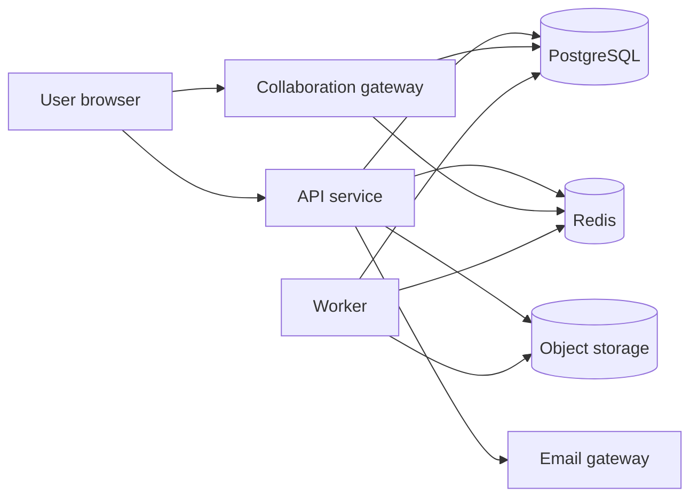

# CollabDocs Software Requirements Specification

| Field | Value |
| --- | --- |
| Product | CollabDocs |
| Audience | Engineering, QA, and AI coding agents |
| Depends on | [PRD](PRD.md) |
| Related | [HLD](../02-architecture/HLD.md), [API](../04-api/API_SPECIFICATION.md), [Traceability](../10-traceability/TRACEABILITY_MATRIX.md) |

## 1. System context

CollabDocs is a browser application. The browser talks to an API for accounts, metadata, and file jobs, and to a collaboration gateway for document bytes and presence. PostgreSQL stores relational data and the collaborative update log. Redis holds ephemeral presence, pub/sub, tickets, and rate-limit counters. Object storage holds avatars, images, and export files. An email gateway sends verification, reset, and invite mail.



Actors are people or external systems that trigger use cases. Services inside the boundary are not actors.

## 2. Actors

| Actor | Description |
| --- | --- |
| Guest | Unauthenticated visitor |
| User | Authenticated account |
| Document owner | User who owns a document |
| Document editor | User whose effective role is editor |
| Document commenter | Effective role commenter |
| Document viewer | Effective role viewer |
| Workspace admin | Workspace role admin or owner |
| Email system | Sends and, in development, captures mail |
| Scheduler | Internal clock that starts compaction, purge, and checkpoint jobs |

## 3. Use cases

| ID | Name | Primary actor | Preconditions |
| --- | --- | --- | --- |
| UC-01 | Register | Guest | Email not registered |
| UC-02 | Verify email | User | Account pending verification |
| UC-03 | Log in | Guest | Verified or pending account, correct password |
| UC-04 | Refresh session | User | Valid refresh cookie |
| UC-05 | Log out | User | Session exists |
| UC-06 | Reset password | Guest | Account exists for email |
| UC-07 | Manage profile | User | Authenticated |
| UC-08 | Delete account | User | Password confirmed |
| UC-09 | Create document | User | Email verified, workspace member |
| UC-10 | Edit document | Editor | Document active, role editor or owner |
| UC-11 | Autosave | Editor | Document open |
| UC-12 | Collaborate | Editor | V2, network available or later reconnect |
| UC-13 | Share document | Owner or workspace admin | Document active |
| UC-14 | Comment | Commenter | V3, range selected |
| UC-15 | Suggest edit | Commenter | V3, suggestion mode |
| UC-16 | Accept suggestion | Editor | V3, suggestion pending |
| UC-17 | Restore version | Editor | V3, version exists |
| UC-18 | Export | Viewer | V4, document readable |
| UC-19 | Import | Member | V4, file passes validation |
| UC-20 | Search documents | Member | Workspace membership |

## 4. Identifier scheme

Functional IDs use `FR-<AREA>-<number>`. Non-functional IDs use `NFR-<AREA>-<number>`. Business rules use `BR-<AREA>-<number>`. Each functional requirement states preconditions, behavior, failure, acceptance, and verification.

Areas: `AUTH`, `DOC`, `EDIT`, `COLLAB`, `SHARE`, `CMT`, `SUG`, `VER`, `EXP`, `ORG`, `NTF`.

## 5. Functional requirements

### 5.1 Authentication and accounts

#### FR-AUTH-001 Register

- **Description.** Create an account and a personal workspace.
- **Input.** Email, display name, password.
- **Preconditions.** Email matches the address grammar. Password meets BR-AUTH-001. Display name meets BR-AUTH-002.
- **Behavior.** Persist user with status `pending_verification`. Hash password with Argon2id. Create workspace named "{displayName}'s Workspace" with the user as owner and member. Create a single-use verification token valid for 24 hours. Send email. Return a session so the user can open the verification screen.
- **Failure.** Duplicate email returns `409 EMAIL_TAKEN` and does not reveal whether the email is verified. Validation errors return `400`.
- **Acceptance.** A new row exists for user, membership, and workspace. Password is not stored or logged in clear text.
- **Verification.** API integration test.
- **PRD.** Section 9.1.

#### FR-AUTH-002 Verify email

- **Description.** Mark the email verified when the token is valid.
- **Behavior.** Token is single-use, stored hashed, expires in 24 hours. Success sets `email_verified_at` and status `active`.
- **Failure.** Expired or unknown token returns `400 TOKEN_INVALID`.
- **Verification.** API test plus mail capture assertion in Docker.

#### FR-AUTH-003 Resend verification

- **Description.** Issue a new token and invalidate the previous one.
- **Failure.** More than 3 resends per hour returns `429`.
- **Verification.** Rate-limit test.

#### FR-AUTH-004 Login

- **Description.** Exchange email and password for an access token and a refresh cookie.
- **Behavior.** Access token is a signed JWT, lifetime 15 minutes, claims `sub`, `sid`, `email_verified`. Refresh token is opaque, 32 bytes, stored as SHA-256, lifetime 30 days, `HttpOnly`, `Secure` in deployed environments, `SameSite=Lax`, path `/api/v1/auth`. A new session family id is created.
- **Failure.** Unknown email or bad password returns the same `401 INVALID_CREDENTIALS`. Disabled users receive `403 ACCOUNT_DISABLED`.
- **Verification.** API test. Response body contains no refresh token.

#### FR-AUTH-005 Refresh

- **Description.** Rotate the refresh token and issue a new access token.
- **Behavior.** The presented token hash must match the current token in the family and be unexpired and unrevoked. The row is replaced. The new token's `replaced_by` chain is recorded. Response sets a new cookie.
- **Failure.** Reuse of a rotated token revokes every session in that family and returns `401 SESSION_REUSED`.
- **Verification.** Concurrency test that replays an old cookie.

#### FR-AUTH-006 Logout and logout-all

- **Description.** Revoke the current session, or every session for the user.
- **Behavior.** Clear the refresh cookie. Access tokens already issued remain valid until their 15-minute expiry. Revoked session ids are cached in Redis until access-token expiry so the API and the collaboration gateway reject them.
- **Verification.** Call a protected route with the old access token after logout and observe `401` once the denylist is visible. Within cache propagation, rejection occurs on the next request that checks Redis.

#### FR-AUTH-007 Forgot and reset password

- **Description.** Email a reset link. Reset sets a new password.
- **Behavior.** Forgot always returns `202` so account existence is not revealed. Reset token lifetime is 30 minutes, single-use, hashed. Success revokes all refresh sessions and session families.
- **Failure.** Weak new password returns `400`.
- **Verification.** API test and denylist assertion.

#### FR-AUTH-008 Profile read and update

- **Description.** The authenticated user reads and updates display name and, later, avatar.
- **Behavior.** Email change is out of MVP. If added later it requires re-verification. Avatar upload is `FR-AUTH-009`.
- **Verification.** API test.

#### FR-AUTH-009 Avatar

- **Description.** Upload or delete a profile image.
- **Input.** PNG, JPEG, or WebP, maximum 2 MB, maximum 2048 px on the long edge after the server inspects dimensions.
- **Behavior.** Store in object storage under `avatars/{userId}/{uuid}`. Persist the object key. Delete removes the object and nulls the key.
- **Failure.** Wrong type or oversize returns `400`. Decoder failure returns `400 UNSUPPORTED_IMAGE`.
- **Verification.** Upload valid and invalid fixtures.

#### FR-AUTH-010 Session list and revoke

- **Description.** List sessions for the current user: created time, last used, user agent, approximate IP prefix. Revoke one session.
- **Behavior.** IP is stored but API returns only the first three octets for IPv4 or a truncated IPv6 prefix.
- **Verification.** API test.

#### FR-AUTH-011 Account deletion

- **Description.** Schedule deletion as specified in PRD section 12.
- **Preconditions.** Current password matches. Body contains `confirmation: "DELETE"`.
- **Behavior.** Status becomes `pending_deletion`. `purge_after` is now plus 7 days. Login before that time cancels deletion.
- **Failure.** If the user is the sole owner of a workspace that still has other members, return `409 WORKSPACE_OWNERSHIP`.
- **Verification.** Integration test with the worker clock advanced.

#### FR-AUTH-012 Authorization on every protected operation

- **Description.** Every route except register, login, refresh, forgot, reset, verify, health, and share-link redeem requires a valid access token whose session is not revoked.
- **Failure.** Missing token `401`. Valid token with insufficient role `403` or `404` per OQ-2.
- **Verification.** Security test suite.

#### FR-AUTH-013 OAuth

- **Description.** Optional later capability. An OAuth identity links to an existing user by verified email or creates a user with `email_verified_at` set from the provider.
- **Status.** Specified, not in V1. No password is set until the user creates one.
- **Verification.** Deferred contract test.

### 5.2 Documents and organization

#### FR-DOC-001 Create document

- **Preconditions.** Caller is an active verified member of the workspace.
- **Input.** Optional title, optional folder id, optional template id.
- **Behavior.** Allocate UUIDv7. Insert document with owner equal to caller, status `active`, epoch `1`, empty Yjs snapshot corresponding to an empty paragraph. If folder id is set, the folder must belong to the same workspace.
- **Failure.** Unknown folder `404`. Unverified email `403 EMAIL_UNVERIFIED`.
- **Verification.** API and database test.

#### FR-DOC-002 Read document metadata

- **Behavior.** Return title, folder, owner, effective role, updated time, star flag, save epoch, and word count cache. Do not return the full collaborative byte payload on this route.
- **Failure.** No access follows OQ-2.

#### FR-DOC-003 Rename

- **Preconditions.** Editor or owner.
- **Input.** Title 1–200 Unicode characters, trimmed, not empty.
- **Behavior.** Update title and `updated_at`. Content bytes do not change.

#### FR-DOC-004 Move

- **Preconditions.** Editor or owner. Destination folder in the same workspace or null for root.
- **Failure.** Cross-workspace move `422`.

#### FR-DOC-005 Duplicate

- **Preconditions.** Effective role at least viewer. The duplicate is a new document owned by the caller in a workspace where the caller is a member. Default destination is the caller's personal workspace root if they cannot create in the source workspace.
- **Behavior.** Copy the latest snapshot into a new document epoch 1. Do not copy permissions, comments, or share links. Copy attachments into new object keys.
- **Verification.** Permission test that a viewer can duplicate into their own workspace and cannot create a document in the source workspace.

#### FR-DOC-006 Trash, restore, purge

- **Trash.** Editor or owner. Sets status `trashed`, `trashed_at`, `purge_after` = trashed_at + 30 days. Collaboration sockets receive `document.trashed` and disconnect.
- **Restore.** Editor or owner while status is trashed and purge has not run.
- **Purge.** Owner only, or the purge worker after `purge_after`. Deletes update log, snapshots not shared with other documents, attachment objects, comments, suggestions, permissions, and the document row.
- **Verification.** Lifecycle integration test.

#### FR-DOC-007 Star

- **Behavior.** Star is per user, not global. Any role with access may star. Unique pair `(user_id, document_id)`.

#### FR-DOC-008 Recent

- **Behavior.** A document enters the caller's recent list when they open it. Return at most 50, ordered by last opened time.

#### FR-DOC-009 List, sort, filter

- **Query.** `folderId`, `status` default `active`, `sort` in `updatedAt`, `title`, `createdAt`, `direction`, `limit` default 50 maximum 100, `cursor`.
- **Behavior.** Cursor pagination is stable on `(sort field, id)`.

#### FR-DOC-010 Empty states

- **Behavior.** An empty folder list returns `200` and `items: []`. The client shows an empty state. This is a client requirement verified by component test.

#### FR-DOC-011 Loading and recovery states

- **Behavior.** While bootstrap content is in flight, the editor is not editable and shows loading. If bootstrap fails with network error, show retry. If `401`, redirect to login. If `403` or `404`, show access denied without a partial document.

#### FR-DOC-012 Templates

- **Behavior.** Creating from a template copies that template snapshot as the initial snapshot. V1 ships no template gallery beyond blank. V4 adds system templates. Unknown template id returns `404`.

#### FR-DOC-013 Ownership

- **Behavior.** Exactly one owner grant exists. Transfer is `FR-SHARE-008`. The owner user id is also denormalized on `documents.owner_id` and updated in the same transaction as the grant change.

#### FR-DOC-014 Identifiers

- **Behavior.** Document ids are UUIDv7, generated by the API, never by the client. Clients treat them as opaque strings.

#### FR-ORG-001 Create folder

- **Preconditions.** Workspace member.
- **Input.** Name 1–120 characters, optional parent in the same workspace.
- **Failure.** Depth greater than 20 returns `422 FOLDER_DEPTH`. Cycle returns `422`.

#### FR-ORG-002 Rename, move, trash folder

- **Behavior.** Trashing a folder trashes descendant folders and documents in one transaction. Restore restores the subtree that was trashed in that operation, identified by `trash_batch_id`.

#### FR-ORG-003 Title search

- **Input.** Query string 1–100 characters.
- **Behavior.** Case-insensitive match on title within documents the caller can access in the workspace. V1 uses PostgreSQL `ILIKE` with a trigram index. Limit 50.
- **Failure.** Empty query returns `400`.

#### FR-ORG-010 Body search

- **Status.** Not in V1–V4 acceptance. Reserved id. When implemented, search an extracted plain-text column produced by the compactor, not a scan of Yjs bytes at request time.

### 5.3 Editor

Editor requirements apply to the browser editor and to the schema the server stores. The server does not interpret every keystroke. It stores Yjs updates that the editor produced from this schema. Schema-invalid updates that the compactor cannot apply fail compaction and raise an alert. They are still stored so data is not dropped.

#### FR-EDIT-001 Document schema

The collaborative fragment `prosemirror` contains these nodes:

| Node | Attrs | Notes |
| --- | --- | --- |
| `doc` | none | Root |
| `paragraph` | `align` in `left`, `center`, `right`, `justify`. Default `left`. `spacingBefore`, `spacingAfter` in points 0–72, default 0. `lineSpacing` in `1`, `1.15`, `1.5`, `2`, default `1.15` | |
| `heading` | `level` 1–6, plus paragraph attrs | V1 UI exposes 1–3 |
| `text` | none | |
| `bulletList` | none | |
| `orderedList` | `start` integer 1–9999 | |
| `listItem` | none | May contain paragraph and nested lists |
| `taskList` | none | V2 UI |
| `taskItem` | `checked` boolean | |
| `blockquote` | none | |
| `horizontalRule` | none | |
| `pageBreak` | none | V4 UI |
| `table` | none | V4 |
| `tableRow` | none | |
| `tableHeader`, `tableCell` | `colspan`, `rowspan`, `align`, `background` | colspan and rowspan 1–10 |
| `image` | `attachmentId`, `alt`, `caption` | V4. `src` is resolved from the attachment API, not stored as an arbitrary URL |
| `hardBreak` | none | |

Marks:

| Mark | Attrs |
| --- | --- |
| `bold`, `italic`, `underline`, `strike`, `code` | none |
| `textStyle` | `fontFamily` from the allow-list, `fontSize` from 8 to 72, `color` as `#RRGGBB` |
| `highlight` | `color` from the highlight allow-list |
| `link` | `href` http, https, or mailto. Maximum 2000 characters |
| `suggestionInsert`, `suggestionDelete` | `suggestionId` UUID |

Allow-listed fonts: `Arial`, `Georgia`, `Times New Roman`, `Courier New`, `Verdana`. The editor maps unknown pasted fonts to Arial.

#### FR-EDIT-002 through FR-EDIT-018 Formatting commands

Each command is enabled when the schema allows it at the selection.

| ID | Command | Acceptance |
| --- | --- | --- |
| FR-EDIT-002 | Bold | Toggles bold on the selection or stored mark |
| FR-EDIT-003 | Italic | Toggles italic |
| FR-EDIT-004 | Underline | Toggles underline |
| FR-EDIT-005 | Strikethrough | Toggles strike |
| FR-EDIT-006 | Font family | Sets allow-listed family |
| FR-EDIT-007 | Font size | Sets integer 8–72 |
| FR-EDIT-008 | Text color | Sets `#RRGGBB` |
| FR-EDIT-009 | Highlight | Sets allow-listed color or clears |
| FR-EDIT-010 | Alignment | Sets paragraph align for selected blocks |
| FR-EDIT-011 | Line spacing | Sets line spacing on selected blocks |
| FR-EDIT-012 | Paragraph spacing | Sets before and after |
| FR-EDIT-013 | Indent | Increases or decreases list indent or block indent level 0–8 |
| FR-EDIT-014 | Clear formatting | Removes marks and resets block attrs in the selection. Does not delete suggestion marks unless the caller is accepting or rejecting |
| FR-EDIT-015 | Inline code | Toggles code mark |
| FR-EDIT-016 | Headings and paragraph | Sets block type |
| FR-EDIT-017 | Lists and task lists | Toggles list type. Nested lists indent |
| FR-EDIT-018 | Link | Sets or removes href after validation |

**Failure.** Invalid color or font returns no document mutation and a toolbar error.

**Verification.** Editor unit tests for each command.

#### FR-EDIT-019 Blockquote, horizontal rule, page break

- **Behavior.** Insert the node at the selection. Page break is stored in V1 schema and shown in the toolbar in V4.

#### FR-EDIT-020 Tables

- **Version.** V4.
- **Behavior.** Insert a table with 1–20 rows and 1–10 columns, default 3 by 3. Commands add and delete rows and columns, merge and split within colspan and rowspan limits, and set cell alignment and background from the allow-list.
- **Failure.** Operations that would exceed limits are disabled.

#### FR-EDIT-021 Images

- **Version.** V4.
- **Behavior.** Upload goes to the attachment endpoint first. The editor inserts an image node with `attachmentId` and required alt text. Empty alt is allowed only if the user explicitly marks the image decorative, stored as `alt: ""` and `decorative: true`.
- **Failure.** Upload failure leaves the document unchanged.

#### FR-EDIT-022 Undo and redo

- **Behavior.** Local history covers local transactions. Applying a remote Yjs update must not clear local history except when a restore epoch replaces the document.
- **Verification.** Two-client manual and automated test: client A types, client B types, client A undo restores only A's last local step if the editor binding supports it. If a step is not invertible, the test records the documented limitation rather than failing convergence.

#### FR-EDIT-023 Clipboard

- **Behavior.** Copy writes text/plain and text/html. Paste prefers HTML sanitized to the schema, then plain text. Scripts, event handlers, and external image URLs are stripped. Pasted images become attachment uploads when the clipboard contains a bitmap. If upload fails, paste the remaining text and show an error for the image.

#### FR-EDIT-024 Keyboard shortcuts

Minimum bindings, disabled when a modal dialog is open except Escape:

| Shortcut | Action |
| --- | --- |
| Mod-B/I/U | Bold, italic, underline |
| Mod-Shift-X | Strikethrough |
| Mod-Z, Mod-Shift-Z, Mod-Y | Undo, redo |
| Mod-A | Select all in the editor when the editor is focused |
| Mod-F | Find |
| Mod-K | Link |
| Mod-Alt-1/2/3 | Heading levels |
| Tab, Shift-Tab | Indent or outdent in lists |

Mod is Ctrl on Windows and Linux and Meta on macOS.

#### FR-EDIT-025 Find and replace

- **Behavior.** Find is case-insensitive by default with a match-case toggle. Replace and replace-all apply to the accepted-text view in editing mode and to the suggestion-aware view in suggestion mode. Replace-all is one undo step.
- **Limit.** A single replace-all mutates at most 5000 matches and then stops with a notice.

#### FR-EDIT-026 Word and character count

- **Behavior.** Character count is Unicode code points in the projected text. Word count splits on Unicode whitespace and ignores empty tokens. Viewing mode and export use the accepted projection: characters with `suggestionInsert` are excluded and characters with `suggestionDelete` are included. Suggestion mode includes pending insertions and excludes pending deletions from the "accepted" subcount and shows both numbers.

#### FR-EDIT-027 Selection, drag and drop, context menu

- **Behavior.** Dragging selected blocks moves them when the drop target is a valid schema position. The context menu offers cut, copy, paste, link, and comment when the role allows. Paste in the menu uses the Clipboard API and shows a message if the browser denied it.

#### FR-EDIT-028 Focus

- **Behavior.** Opening a document focuses the editor body unless the user landed on a comment permalink, in which case focus moves to that thread.

#### FR-EDIT-029 Browser refresh

- **Behavior.** After reload, the client loads the server snapshot and tail. V2 also loads IndexedDB and syncs the difference. Content that was acknowledged is present.

#### FR-EDIT-030 Schema migration

- **Behavior.** Each stored snapshot records `schemaVersion`. Current version is `1`. A migration is a pure function from version N to N+1 run by the compactor before it writes the next snapshot. Clients refuse to edit if the server schema version is newer than the client and show an upgrade message. Older snapshots remain readable through migration on read.

#### FR-EDIT-031 Clear formatting failure mode

- **Behavior.** Clear formatting does not split suggestion ids. If a selection partially covers a suggestion, the suggestion mark remains and a non-blocking notice explains that suggestion formatting is resolved through accept or reject.

#### FR-EDIT-032 Editor disabled states

- **Behavior.** The editor is read-only for viewers and commenters in viewing mode. Commenters in suggestion mode may create suggestion transactions only. The toolbar reflects the role.

#### FR-EDIT-036 Shortcuts do not bypass roles

- **Behavior.** A read-only client does not dispatch mutating commands. The server still rejects the update if a modified client sends one.

### 5.4 Collaboration

#### FR-COLLAB-001 Representation

- **Behavior.** One document maps to one Yjs document whose durable encoding is the sequence of updates in the current epoch applied on top of the epoch's base snapshot. The server stores those bytes. It does not replace the document with a JSON blob on each save.

#### FR-COLLAB-002 Local apply

- **Behavior.** The editor applies the user's transaction to the local Y.Doc before the network round trip.

#### FR-COLLAB-003 Transmit

- **Behavior.** The client sends each Yjs update once, with a client-generated UUID `updateId`, over the collaboration socket. V1, which has no multi-user gateway yet, posts the same payload to `POST /api/v1/documents/{id}/content-updates`.

#### FR-COLLAB-004 Remote merge

- **Behavior.** Receiving clients apply the update with `Y.applyUpdate`. Convergence is the Yjs CRDT guarantee for updates that all peers eventually apply.

#### FR-COLLAB-005 Persist

- **Behavior.** The gateway inserts the update in PostgreSQL, then acknowledges, then fans out. Acknowledgement includes the assigned `(epoch, seq)`.

#### FR-COLLAB-006 Join sync

- **Behavior.** On subscribe, the server sends the latest snapshot for the current epoch and every update with `seq` greater than the snapshot's `throughSeq`. If no snapshot exists, it sends every update in the epoch.

#### FR-COLLAB-007 Restart

- **Behavior.** In-memory rooms are disposable. After a gateway restart, clients reconnect and run join sync against PostgreSQL. Committed updates are present.

#### FR-COLLAB-008 Snapshots and increments

- **Behavior.** A snapshot is a full `Y.encodeStateAsUpdate` result plus the highest `seq` it includes. Increments after that seq are authoritative until the next snapshot. Compaction never deletes an update that is newer than the latest snapshot.

#### FR-COLLAB-009 Room distribution

- **Behavior.** Any gateway instance may hold the socket. Fan-out uses Redis pub/sub channel `collab:doc:{documentId}`. Sequence assignment uses a PostgreSQL transaction so two instances cannot commit the same seq.

#### FR-COLLAB-010 Stale and unauthorized sessions

- **Behavior.** The gateway checks the access token, session denylist, and document role at connect and at an interval of 60 seconds. Failure closes the socket with a specific code.

#### FR-COLLAB-011 Presence and cursors

- **Behavior.** Awareness states include user id, display name, color, caret anchor, and selection head. They are ephemeral in Redis with a 30-second TTL refreshed by heartbeat. They are not written to the document update log.

#### FR-COLLAB-012 Join and leave

- **Behavior.** The client shows a presence list driven by awareness. Leave is connection close or TTL expiry. No permanent "user joined" document edit is inserted.

#### FR-COLLAB-013 Reconnect

- **Behavior.** The client retries with exponential backoff from 500 ms to 10 s, full jitter. It resends unacknowledged update ids. The server's unique constraint makes the resend safe.

#### FR-COLLAB-014 Offline

- **Version.** V2 stores the Y.Doc and the outbound update queue in IndexedDB. While offline the UI shows "Saved on this device". Edits stay in the local CRDT. When online, the queue flushes in order. If the server epoch changed, the client discards the local document, loads the server state, and shows that offline edits could not be merged into a restored version. Those offline updates are downloadable as a recovery file for support. Silent merge across restore is forbidden.

#### FR-COLLAB-015 Idempotency

- **Behavior.** Unique `(document_id, client_id, update_id)`. A duplicate returns the original ack and is not appended again.

#### FR-COLLAB-016 Access revoke during edit

- **Behavior.** Within 5 seconds of commit of the revoke, sockets for that user on that document close with code `4403`. In-flight updates not yet committed are rejected. Updates already committed stay.

#### FR-COLLAB-017 Large documents

- **Behavior.** If applying an update would make encoded state exceed `COLLAB_MAX_STATE_BYTES` (default 2_097_152), the server rejects that update with `PAYLOAD_TOO_LARGE` and the client undoes the local transaction that produced it if it is still the latest local transaction. If it cannot undo cleanly, it reloads from the server.

#### FR-COLLAB-018 Read-only connections

- **Behavior.** Viewers and commenters who are not in suggestion mode may connect and receive updates and may send awareness. Content updates from them are rejected with `4403`.

### 5.5 Sharing

#### FR-SHARE-001 Grant user

- **Preconditions.** Owner or workspace admin.
- **Input.** User id or email, role `viewer`, `commenter`, or `editor`.
- **Behavior.** Existing user receives a permission row. Unknown email receives a pending invite and an email. Accepting the invite after signup binds the grant.

#### FR-SHARE-002 Change role

- **Behavior.** Updating a grant writes audit and publishes an ACL event.

#### FR-SHARE-003 Revoke

- **Behavior.** Sets `revoked_at`. Does not delete the row. Connected clients are dropped.

#### FR-SHARE-004 Link sharing

- **Preconditions.** Workspace policy `linkSharing` is not `disabled`. Default policy is `enabled_commenter_max`.
- **Input.** Role viewer or commenter, optional expiry no more than 90 days.
- **Behavior.** Raw token is returned once. Only the hash is stored.

#### FR-SHARE-005 Redeem link

- **Behavior.** A logged-in user who redeems a valid link receives a permission grant of that role if they do not already have a higher role.

#### FR-SHARE-006 Revoke link

- **Behavior.** Sets `revoked_at`. Existing grants already created by redemption remain until separately revoked. The link cannot create new grants.

#### FR-SHARE-007 Link expiry

- **Behavior.** Expired links fail redeem with `410 LINK_EXPIRED`.

#### FR-SHARE-008 Transfer ownership

- **Preconditions.** Current owner. Target already has an account and will receive an owner grant.
- **Behavior.** Previous owner becomes editor in the same transaction. `documents.owner_id` updates.

#### FR-SHARE-009 Access request

- **Behavior.** A logged-in user may request access. Owner receives a notification. Approve creates a grant. Deny records the decision. Duplicate open requests return the existing request.

#### FR-SHARE-010 Inheritance

- **ID reserved.** `FR-SHARE-014` implements folder ACL in a later version. Until then, documents do not inherit folder roles. Workspace admin access is BR-SHARE-004.

#### FR-SHARE-011 Audit

- **Behavior.** Share, revoke, link create, link revoke, transfer, approve, and deny write `audit_events`.

#### FR-SHARE-012 Enforcement points

- **Behavior.** The API authorizes REST mutations. The gateway authorizes sockets and each content update. The worker re-checks the requester's role at export start and at download. Attachment download checks document read. Comment create checks commenter. Suggestion accept checks editor.

#### FR-SHARE-013 Pending email invite

- **Behavior.** An invite expires in 14 days. It grants nothing until the email is verified and matches.

#### FR-SHARE-015 Owner cannot be revoked by role change

- **Behavior.** The owner grant cannot be deleted except through transfer.

#### FR-SHARE-016 Self-share

- **Behavior.** Granting the owner again returns the existing owner row and does not downgrade it.

### 5.6 Comments

#### FR-CMT-001 Create thread

- **Preconditions.** Commenter or higher. Selection is non-empty and inside the document.
- **Input.** Body 1–5000 characters, anchor relative positions, quoted text up to 500 characters.
- **Behavior.** Create thread and first comment in one transaction.

#### FR-CMT-002 Reply

- **Behavior.** One level of replies. A reply to a reply attaches to the thread root.

#### FR-CMT-003 Edit and delete

- **Behavior.** Author may edit their comment for 15 minutes, or owner may delete any comment. Delete is soft. A thread with all comments deleted shows as removed.

#### FR-CMT-004 Resolve and reopen

- **Preconditions.** Commenter or higher. Reopen is the same.
- **Behavior.** Status `open` or `resolved`. Resolved threads stay listed under a filter.

#### FR-CMT-005 Mentions

- **Input.** Body may include up to 20 mention tokens of users who can access the document.
- **Behavior.** Each mention creates a notification. Mentioning a user without access returns `422`.

#### FR-CMT-006 Anchor survival

- **Behavior.** Anchors are Yjs relative positions created on the client against the current document. On later load, the client rebinds them. If either side no longer maps, the thread is `detached` and remains readable.

#### FR-CMT-007 Restore interaction

- **Behavior.** Version restore does not delete comments. Clients recompute detached state after the new epoch loads.

#### FR-CMT-008 Permissions

- **Behavior.** Viewers read threads. They cannot post. A user who loses access stops receiving thread payloads.

#### FR-CMT-009 Notifications

- **Behavior.** Reply notifies the thread participants except the actor. Mention notifies the mentioned user.

#### FR-CMT-010 Edit window failure

- **Behavior.** Edit after 15 minutes returns `409 COMMENT_LOCKED` unless the caller is owner, who still cannot rewrite body after the window but can delete.

#### FR-CMT-011 Concurrent anchor

- **Behavior.** Two threads on the same range are both valid.

#### FR-CMT-012 Comment does not change accepted text

- **Behavior.** Creating a comment does not insert a content update.

### 5.7 Suggestions

#### FR-SUG-001 Mode

- **Behavior.** Suggestion mode is a client mode available to commenter and higher. Transactions in that mode must create or extend `suggestionInsert` or `suggestionDelete` marks with a new or existing suggestion id owned by the actor. Direct mutations of accepted text in this mode are rejected by the client. A hostile client that sends an unmarked update is rejected by the gateway when the connection's `intent` is `suggest`. Editors who want to edit directly use intent `edit`.

#### FR-SUG-002 Insert suggestion

- **Behavior.** Inserted characters carry `suggestionInsert`. They are not in the accepted projection.

#### FR-SUG-003 Delete suggestion

- **Behavior.** Characters remain and gain `suggestionDelete`. They stay in the accepted projection until accepted.

#### FR-SUG-004 Format suggestion

- **Behavior.** A format suggestion stores the proposed mark set in `suggestions.payload` and a Yjs mark `suggestionFormat` on the range. Accepted projection keeps current marks until accept. V3 may ship format suggestions after insert and delete if schedule slips. The id remains reserved. The roadmap marks format suggestions as V3 exit criteria. They are in scope for V3.

#### FR-SUG-005 Accept

- **Preconditions.** Editor or owner. Status pending.
- **Behavior.** Accept runs as a Yjs update attributed to the resolver: insert suggestion drops the mark and keeps text; delete suggestion deletes the characters; format suggestion applies payload marks and drops the suggestion mark. The suggestion row becomes `accepted`.

#### FR-SUG-006 Reject

- **Behavior.** Insert suggestion deletes the characters. Delete suggestion drops the mark. Format suggestion drops the mark and does not apply payload. Status `rejected`.

#### FR-SUG-007 Accept all and reject all

- **Behavior.** Applies to pending suggestions on that document in creation order, one compacted undo step from the user's point of view, implemented as one or more Yjs updates plus row updates in one database transaction for the status rows. If the content update fails, status rows roll back.

#### FR-SUG-008 Attribution

- **Behavior.** Each suggestion records author, created time, resolver, and resolved time.

#### FR-SUG-009 Concurrent review

- **Behavior.** Two resolvers may race. The second receives `409 SUGGESTION_RESOLVED` if the row is no longer pending. Content updates still converge through CRDT. The status transaction uses `UPDATE ... WHERE status = 'pending'`.

#### FR-SUG-010 History

- **Behavior.** Accepted and rejected suggestions remain queryable. They are not removed by compaction.

### 5.8 Versions

#### FR-VER-001 Automatic checkpoint

- **Behavior.** The compactor writes a snapshot according to policy: at least 100 new updates or 5 minutes since the last snapshot, and only if `throughSeq` would advance. The snapshot row is also a version row with `kind = automatic`.

#### FR-VER-002 Named version

- **Preconditions.** Editor. Label 1–120 characters.
- **Behavior.** Forces a snapshot immediately and sets label and `kind = named`.

#### FR-VER-003 List

- **Behavior.** Returns versions newest first with author display name, time, kind, and label. Automatic versions older than 90 days are omitted from the default list but retained if named or if within the last 100 automatic versions, whichever keeps more.

#### FR-VER-004 Preview

- **Behavior.** Returns read-only HTML rendered by the worker from that snapshot's accepted projection. It does not open a collaboration room for the old epoch.

#### FR-VER-005 Compare

- **Behavior.** Returns a structural diff of accepted plain text and a list of block-level changes. It is not a pixel diff. V3 delivers paragraph-level insert and delete highlighting.

#### FR-VER-006 Restore

- **Preconditions.** Editor. Confirmation flag `confirm: true`.
- **Behavior.** Increment document epoch. Write the chosen snapshot bytes as the base snapshot of the new epoch at seq 0. Publish `document.restored`. Old epoch updates are retained for audit and are not applied to the new epoch. Connected clients must reset local state.
- **Failure.** Missing confirm returns `400`.

#### FR-VER-007 Active collaborators during restore

- **Behavior.** The gateway rejects updates with the old epoch. Clients show a modal: the document was restored, and reload into the new epoch. Offline clients that reconnect with the old epoch follow `FR-COLLAB-014`.

#### FR-VER-008 Autosave status

- **Behavior.** Client states:
  - `local` — transactions not yet acknowledged
  - `saving` — sent, waiting for ack
  - `saved` — every local update through the current client state vector has an ack
  - `error` — ack failed or socket closed with unacked updates
  Saved maps to durable commit, not merely to socket send.

#### FR-VER-009 Crash recovery

- **Behavior.** Browser crash loses only unacked memory updates in V1. V2 recovers unacked updates from IndexedDB if the process died after the write. Server crash loses nothing that was acknowledged.

#### FR-VER-010 Retention

- **Behavior.** Update rows covered by a snapshot and older than 7 days may be deleted if no restore audit needs the individual updates. Named snapshots are kept for the life of the document. Automatic snapshots follow FR-VER-003.

### 5.9 Import and export

#### FR-EXP-001 Create export job

- **Preconditions.** Viewer or higher.
- **Input.** Format `pdf`, `docx`, `html`, or `txt`. Option `includeSuggestions` boolean, default false.
- **Behavior.** Insert job `queued`, enqueue Redis stream `jobs:export`.

#### FR-EXP-002 Export status and download

- **Behavior.** Requester or any user with read access may poll. Download URL is a short-lived API redirect that checks permission and streams the object. Object keys are not guessable public URLs.

#### FR-EXP-003 Export failure

- **Behavior.** Worker sets `failed` and an error code. Retry is a new job. Poison messages after 3 attempts stay failed.

#### FR-EXP-004 PDF, DOCX, HTML, text

- **Behavior.** Render the accepted projection unless `includeSuggestions` is true. Text export is plain paragraphs. HTML export is sanitized schema HTML without script. DOCX uses the fidelity matrix. PDF is rendered from the HTML projection.

#### FR-EXP-005 Import

- **Input.** DOCX or HTML, maximum 20 MB.
- **Behavior.** Job creates a new document owned by the importer. Validation failure does not create a document. Success replaces the initial empty snapshot with the converted snapshot.

#### FR-EXP-006 Fidelity matrix

Preserved when the construct exists in the schema:

| Construct | DOCX import | HTML import | DOCX export | HTML export | PDF | Text |
| --- | --- | --- | --- | --- | --- | --- |
| Headings, paragraphs, bold, italic, underline, lists, links | yes | yes | yes | yes | yes | text only |
| Tables | yes, flattened if nested | yes, nested tables flattened | yes | yes | yes | skipped with placeholder |
| Images | yes, stored as attachments | yes if data URI or same-origin upload, remote URLs dropped | yes | yes | yes | placeholder |
| Comments | DOCX comments become threads when anchors map | no | yes if includeComments | no | no | no |
| Suggestions | DOCX revisions become suggestions when detected | no | yes if includeSuggestions | visible text only | optional | accepted text |
| Headers, footers, page numbers | stored as document settings when parsed | no | yes in V4 | no | yes in V4 | no |
| Fonts outside the allow-list | mapped to Arial | mapped to Arial | allow-list font | allow-list font | allow-list font | n/a |

The import report lists dropped constructs.

#### FR-EXP-007 Size limits

- **Behavior.** Reject import over 20 MB or more than 2000 images. Reject export if snapshot exceeds the collab max.

#### FR-EXP-008 Permissions

- **Behavior.** A user who loses read access before download receives `403` even if the job succeeded.

#### FR-EXP-009 Images during import

- **Behavior.** Embedded images become attachments. External image URLs are not fetched. This avoids server-side request forgery.

#### FR-EXP-010 Job visibility

- **Behavior.** A user sees import jobs they created and export jobs for documents they can read.

#### FR-EXP-011 Idempotency

- **Behavior.** Clients send `Idempotency-Key` on export create. The same key, user, document, and format within 24 hours returns the original job.

#### FR-EXP-012 Plain text

- **Behavior.** UTF-8, paragraphs separated by blank lines, no formatting.

### 5.10 Notifications

#### FR-NTF-001 Create notification

- **Events.** Share invite, access request, mention, comment reply, suggestion resolved, export ready.
- **Behavior.** Persist a row. The client polls every 30 seconds in V3 and may subscribe to a user channel in V5.

#### FR-NTF-002 Read state

- **Behavior.** A user marks one or all of their notifications read. They cannot read another user's rows.

## 6. Business rules

| ID | Rule |
| --- | --- |
| BR-AUTH-001 | Password length 12–128. At least one letter and one number. Compared as Unicode code points. Checked against a denylist of the 10,000 most common passwords bundled in the API image. |
| BR-AUTH-002 | Display name 1–80 characters after trim. No control characters. |
| BR-AUTH-003 | Access token lifetime 15 minutes. Refresh lifetime 30 days. |
| BR-DOC-001 | A document has one owner. |
| BR-DOC-002 | Trashed documents are not editable. |
| BR-SHARE-001 | Effective role is the maximum of applicable grants. Order: viewer < commenter < editor < owner. |
| BR-SHARE-002 | Link role cannot exceed workspace policy. Default maximum is commenter. |
| BR-SHARE-003 | Editor links are off unless policy `allowEditorLinks` is true. |
| BR-SHARE-004 | Workspace admin and workspace owner have effective editor on every document in the workspace, and owner-equivalent sharing power. This is audited. Confirm OQ-3 before building admin override. Until confirmed, implement the override behind configuration `WORKSPACE_ADMIN_IMPLICIT_ACCESS` default `true` in development and documented for production. |
| BR-SHARE-005 | Guests are not workspace-wide readers. |
| BR-COLLAB-001 | Only the current epoch accepts new updates. |
| BR-COLLAB-002 | Acknowledgement implies a committed database row. |
| BR-VER-001 | Restore increments epoch and requires `confirm: true`. |
| BR-CMT-001 | Comment body is plain text. |
| BR-EXP-001 | The server does not fetch remote URLs during import. |

## 7. Validation rules

| Input | Rule |
| --- | --- |
| Email | Maximum 254, contains one `@`, stored lowercase |
| UUID path params | RFC 4122 string form |
| Title | Trim, 1–200 |
| Folder name | Trim, 1–120 |
| Comment body | 1–5000, control characters rejected except newline and tab |
| Color | `^#[0-9A-Fa-f]{6}$` |
| Link href | `http`, `https`, or `mailto` only |
| Pagination limit | 1–100 |
| Upload content type | Must match sniffed bytes, not only the header |

## 8. Error handling

Errors use one JSON shape:

```json
{
  "error": {
    "code": "VALIDATION_FAILED",
    "message": "Title is required",
    "details": [{ "field": "title", "issue": "blank" }],
    "correlationId": "01J..."
  }
}
```

| HTTP | When |
| --- | --- |
| 400 | Validation, bad token, missing confirm |
| 401 | Missing or invalid authentication |
| 403 | Authenticated but not allowed, when the resource is known to the caller |
| 404 | Resource missing, or hidden because the caller must not learn it exists |
| 409 | Conflict, duplicate, stale suggestion |
| 410 | Expired link |
| 413 | Body too large |
| 422 | Semantically invalid, such as folder cycle |
| 429 | Rate limit. `Retry-After` is set |
| 503 | Dependency unavailable. Client may retry idempotent reads |

The server logs the exception class and correlation id. It does not return stack traces.

## 9. Accessibility requirements

| ID | Requirement |
| --- | --- |
| NFR-A11Y-001 | WCAG 2.2 AA for registration, login, document list, editor, share dialog, comments, and export status |
| NFR-A11Y-002 | Every interactive control has an accessible name |
| NFR-A11Y-003 | Text and background contrast at least 4.5:1 for body text |
| NFR-A11Y-004 | Focus is visible. Dialogs trap focus and restore it on close |
| NFR-A11Y-005 | Status messages for save, disconnect, and export use a polite live region |
| NFR-A11Y-006 | Editor commands in section FR-EDIT-024 are available from the keyboard |
| NFR-A11Y-007 | Color is not the only indicator of presence or suggestion type. Suggestions also use labels |
| NFR-A11Y-008 | Zoom to 200% does not remove the ability to reach the toolbar or document list |

## 10. Security requirements

| ID | Requirement |
| --- | --- |
| NFR-SEC-001 | Passwords hashed with Argon2id. Parameters live in deployment config and start at memory 19 MiB, iterations 2, parallelism 1 |
| NFR-SEC-002 | Refresh tokens stored hashed. Raw token only in the cookie |
| NFR-SEC-003 | Access tokens signed with an asymmetric key. Public key available to the gateway |
| NFR-SEC-004 | CSRF: cookie-authenticated refresh uses `SameSite=Lax` and a custom header `X-CollabDocs-Request: 1` that simple cross-site forms cannot set |
| NFR-SEC-005 | Document HTML rendering sanitizes to the schema |
| NFR-SEC-006 | Import does not perform outbound requests |
| NFR-SEC-007 | Rate limits in the NFR capacity document are enforced at the API |
| NFR-SEC-008 | Audit events are append-only from the application role |
| NFR-SEC-009 | TLS terminates at the reverse proxy in deployed environments |
| NFR-SEC-010 | Session revocation is enforced on API and collaboration paths |

Detailed threats: [SECURITY.md](../05-security/SECURITY.md).

## 11. Performance requirements

These are proposed goals until benchmarked. Method and environments are in [NFR_AND_CAPACITY.md](../07-quality/NFR_AND_CAPACITY.md).

| ID | Target |
| --- | --- |
| NFR-PERF-001 | API read p95 under 200 ms at 50 requests per second on the small deployment profile, excluding cold start |
| NFR-PERF-002 | Local editor input p95 under 30 ms for a document at 100 KB snapshot |
| NFR-PERF-003 | Collaboration delivery p95 under 200 ms between two clients on one gateway after durable commit, small profile |
| NFR-PERF-004 | Document bootstrap p95 under 1.5 s for 100 KB snapshot |
| NFR-PERF-005 | Durable ack p95 under 500 ms for a 16 KB update on the small profile |
| NFR-PERF-006 | Title search p95 under 300 ms for 50,000 documents in a workspace |

## 12. Availability requirements

| ID | Target |
| --- | --- |
| NFR-AVAIL-001 | Small deployment target 99.5% monthly for API read of metadata |
| NFR-AVAIL-002 | Medium and large proposed target 99.9% monthly |
| NFR-AVAIL-003 | RPO for acknowledged content is 0 beyond the database's committed transaction. Unacknowledged content may be lost |
| NFR-AVAIL-004 | RTO target 60 minutes for the small profile and 30 minutes for the medium profile, using documented restore |

## 13. Compatibility requirements

| ID | Requirement |
| --- | --- |
| NFR-COMPAT-001 | Latest two versions of Chrome, Firefox, Edge, and Safari on desktop |
| NFR-COMPAT-002 | Safari on current iPadOS for the tablet layout in V4 |
| NFR-COMPAT-003 | API is versioned under `/api/v1`. Breaking changes require `/api/v2` |
| NFR-COMPAT-004 | Collaboration subprotocol `collabdocs.v1` |

## 14. Traceability

Every `FR-*` and `NFR-*` identifier in this document is mapped to design, data, API, tests, and a roadmap version in [TRACEABILITY_MATRIX.md](../10-traceability/TRACEABILITY_MATRIX.md).

## 15. Open product questions

The defaults in PRD OQ-1 through OQ-5 apply. Implementation must read those defaults from configuration where this SRS names a flag, so a confirmed change does not require a schema rewrite.
