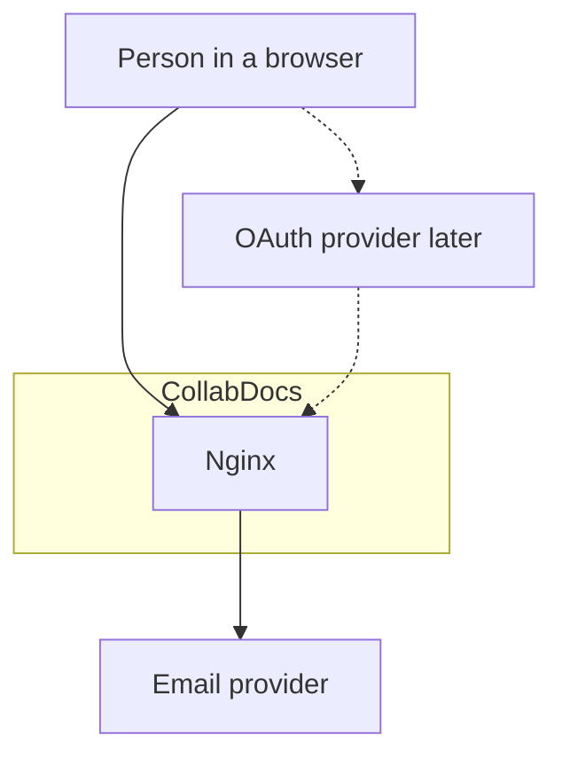
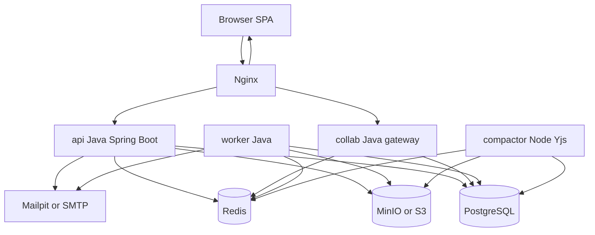
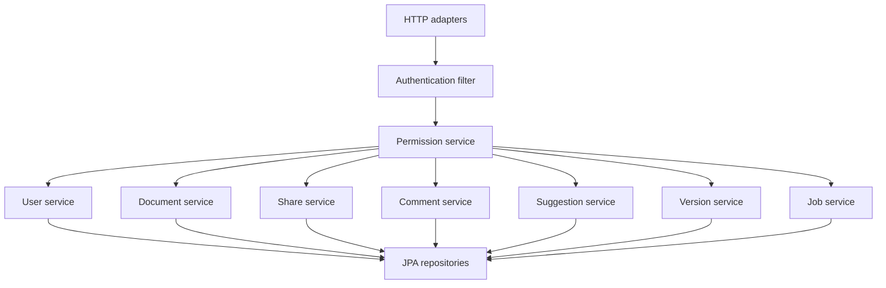
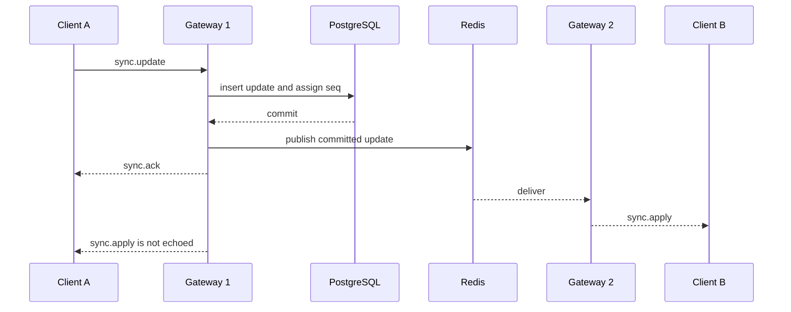
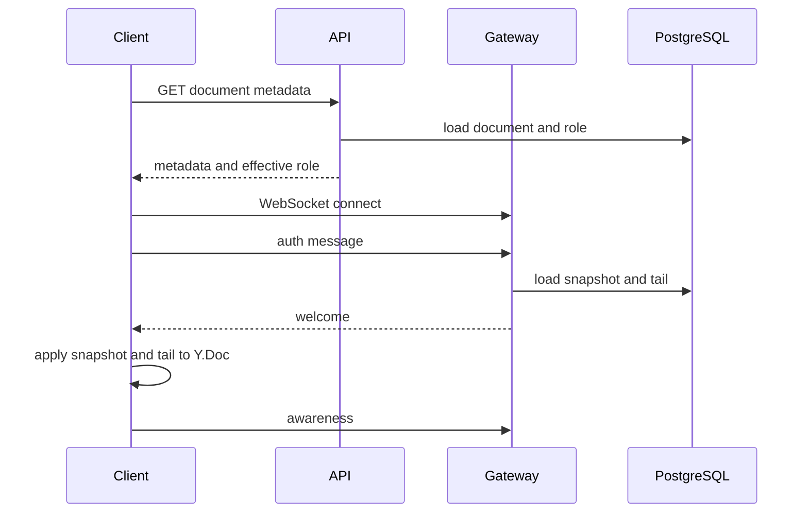
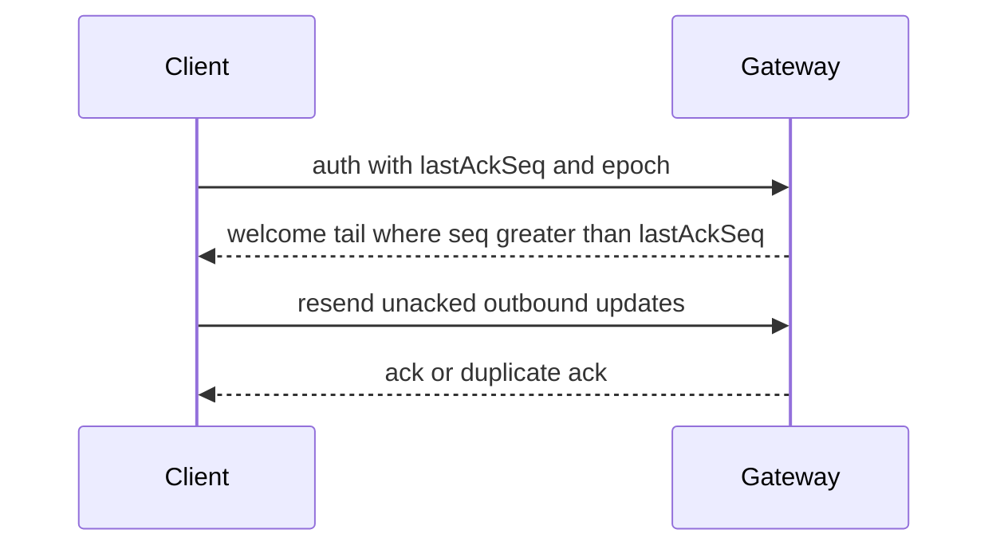
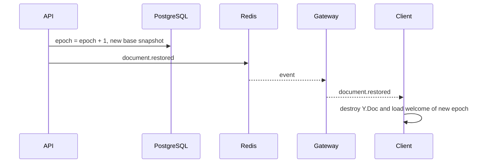
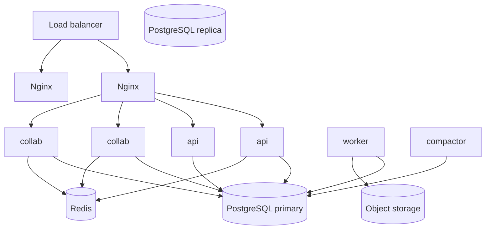

# CollabDocs System Architecture and High-Level Design

| Field | Value |
| --- | --- |
| Audience | Engineers and AI coding agents |
| Depends on | [PRD](../01-product/PRD.md), [SRS](../01-product/SRS.md) |
| Decisions | [ADRs](ADRS.md) |
| Detail | [LLD](LLD.md), [Collaboration protocol](../04-api/COLLABORATION_PROTOCOL.md) |

## 1. Architecture overview

CollabDocs splits interactive document bytes from relational product data.

- The browser owns the editing surface and a local Yjs document.
- The API, written in Java, owns identity, authorization decisions, metadata, jobs, and audit.
- The collaboration gateway, written in Java, owns WebSocket sessions, durable sequencing of opaque Yjs updates, and fan-out.
- The compactor, a small Node.js process, is the only component that executes Yjs. It folds an update log into snapshots and plain text for search later. It does not own business rules.
- Workers, written in Java, render exports, convert imports, send email, and purge expired data.
- PostgreSQL is the system of record for both metadata and collaborative updates.
- Redis is ephemeral: pub/sub, presence, rate limits, session denylist, and the job stream.
- Object storage holds binary assets.

"Saved" means the gateway or the V1 content-update API has committed the Yjs update in `collab_updates` and returned an acknowledgement. Broadcasting without that commit is not part of the design.

## 2. Architecture style and rationale

The style is a modular set of containers with a shared relational database, not a set of independently deployed databases per feature.

Why this shape:

- Document permissions, versions, and comments must stay transactionally aligned with metadata. One PostgreSQL database makes those transactions straightforward.
- Collaborative bytes must not use last-write-wins on a single JSON column. An append-only update log plus CRDT merge on clients provides convergence.
- Yjs has a production JavaScript implementation and no production JVM implementation. Putting every business service in Java and isolating Yjs to the compactor respects the Java backend constraint without pretending a Java CRDT port exists.
- A single deployable "modular monolith" would also work at small scale. Separate `api`, `collab`, and `worker` processes are still used from V1 so WebSocket load and CPU-heavy export do not restart the API. They share one Maven multi-module repository and one database.

The alternative of a pure JavaScript backend was rejected because the product constraint requires Java for backend services. The alternative of implementing Yjs merge inside Java was rejected because maintaining a second CRDT engine would risk divergence. See ADR-001 through ADR-004.

## 3. System context



The browser is the only required client. The email provider is external in production and Mailpit in development. OAuth providers are unused until `FR-AUTH-013` is scheduled.

## 4. Container diagram



| Container | Responsibility | Not responsible for |
| --- | --- | --- |
| `web` | SPA assets. Vite dev server in development. Static files in production | Authorization decisions |
| `nginx` | TLS termination in deployed environments, routing, WebSocket upgrade, request size limits | Business rules |
| `api` | REST, auth, permissions, metadata, job creation | Applying Yjs updates |
| `collab` | WebSocket protocol, update persistence, fan-out, presence | Export rendering |
| `worker` | Import, export, mail, purge, account deletion | Interactive editing |
| `compactor` | Snapshots, schema migration functions, accepted-text extraction | User authentication UI |
| `postgres` | Durable system of record | Pub/sub |
| `redis` | Ephemeral coordination | Source of truth for document bytes |
| `minio` | Avatars, attachments, export artifacts, large snapshots | Queries |

## 5. Component diagram — API



Package root: `com.collabdocs`. Modules: `collabdocs-common`, `collabdocs-api`, `collabdocs-collab`, `collabdocs-worker`.

## 6. Frontend architecture

The SPA is a Vite build of React and TypeScript. Production does not run a Node server for the UI. Nginx serves `index.html` and hashed assets.

State is split:

- Server cache for REST resources, using TanStack Query.
- Editor store for the open document: Y.Doc, connection status, save status, role, suggestion mode.
- UI store for transient panel state, using Zustand.

The editor is Tiptap on ProseMirror, bound to Yjs with `y-prosemirror`. The document fragment name is `prosemirror`.

Routes and component detail: [FRONTEND_DESIGN.md](../06-frontend/FRONTEND_DESIGN.md).

## 7. Backend architecture

### 7.1 API

Stateless. Horizontal copies do not share heap. Session validity beyond JWT expiry checks is the Redis denylist plus the refresh-token table.

Transactions use PostgreSQL read committed. Permission changes and ownership transfer run in one transaction. The API publishes a Redis message after commit.

### 7.2 Collaboration gateway

Stateless regarding document bytes. Each connection subscribes to `collab:doc:{documentId}` after authorization.

Persistence path for a content update:

1. Parse and validate the envelope.
2. Reject the update when the epoch does not match, the role cannot write, the session is denied, or the payload exceeds 256 KB.
3. Insert `collab_updates` with `ON CONFLICT (document_id, client_id, update_id) DO NOTHING`.
4. Assign `seq` from `document_epochs.last_seq` using `UPDATE ... RETURNING` in the same transaction.
5. Commit.
6. Publish the committed update on Redis.
7. Send `sync.ack` to the origin and `sync.apply` to local peers.

If the database is unavailable, the gateway does not ack and does not fan out. Clients keep the update in the outbound queue.

### 7.3 Compactor

Polls `document_epochs` where `last_seq - snapshot_through_seq >= 100` or the snapshot is older than 5 minutes while the document is dirty. Loads the base snapshot and subsequent updates, applies them in a Y.Doc, writes the next snapshot, and updates `snapshot_through_seq`.

Compaction failure leaves the update log intact. The next attempt retries. After 5 failures the document is flagged `compaction_status = failed` and editing continues.

### 7.4 Worker

Consumes Redis stream `jobs:export` and `jobs:import` with a consumer group. Email uses stream `jobs:mail`. Purge uses a scheduled tick inside the worker every 5 minutes.

## 8. Collaboration architecture



The origin applies the update locally before send, so it does not apply its own update again. Other clients apply `sync.apply`.

### 8.1 How the ten collaboration questions are answered

1. **Representation.** A Y.Doc with fragment `prosemirror`, plus a `Y.Map` named `meta` for suggestion records the client mirrors. The server's durable form is snapshot bytes plus ordered updates for one epoch.
2. **Local changes.** ProseMirror transactions map through `y-prosemirror` into the local Y.Doc immediately.
3. **Transmission.** Collaboration subprotocol `collabdocs.v1`, binary payload wrapped in a framed envelope. V1 single-user mode uses the HTTP endpoint with the same bytes.
4. **Remote merge.** `Y.applyUpdate` on each client. Concurrent inserts and deletes commute at the CRDT level.
5. **Persistence.** Insert into `collab_updates` before ack.
6. **New participant.** `welcome` contains base snapshot, `throughSeq`, and the tail.
7. **Server recovery.** No durable state lives only in gateway memory. Restart reloads from PostgreSQL on the next join.
8. **Snapshots and increments.** Clients and the compactor start from the snapshot and apply `seq > throughSeq`. The snapshot is a cache of the log, not a second source of truth. If a snapshot is corrupt, the compactor rebuilds from epoch base seq 0 and the full log if those updates were not yet pruned. Pruning happens only after a newer snapshot exists and the retention window passes.
9. **Distribution.** Redis pub/sub fans out committed updates. PostgreSQL assigns order. Sticky sessions are unnecessary.
10. **Stale sessions.** Token check, Redis denylist, and permission re-check on a 60-second timer and on each update.

### 8.2 Document open



V1 opens through `GET /content-state` instead of the socket. The payload shape matches `welcome.body`.

### 8.3 Reconnect



### 8.4 Restore



## 9. Data storage architecture

| Data | Store | Reason |
| --- | --- | --- |
| Users, sessions, workspaces, folders, ACL, comments, suggestion rows, jobs, audit | PostgreSQL | Relational integrity and transactions |
| Yjs updates and small snapshots | PostgreSQL `bytea` | Ordering and durability with metadata |
| Snapshots larger than 512 KB | Object storage, key on the snapshot row | Avoid oversized rows |
| Presence, denylist, rate limits, pub/sub, job streams | Redis | Ephemeral and fast |
| Avatars, attachments, exports | Object storage | Binary and large |
| IndexedDB | Browser only | Offline queue in V2 |

Schema: [DATABASE_DESIGN.md](../03-data/DATABASE_DESIGN.md).

## 10. Import and export

The worker builds an accepted-text ProseMirror JSON document by asking the compactor HTTP endpoint `POST /internal/project` with snapshot bytes. The compactor applies Yjs and returns canonical JSON plus a warning list. The worker then:

- DOCX: Apache POI.
- HTML: a constrained serializer.
- PDF: OpenHTMLToPDF from that HTML.
- Text: paragraph walker.
- Import: POI or Jsoup produces canonical JSON. The compactor endpoint `POST /internal/encode` returns Yjs snapshot bytes. The worker stores that snapshot as epoch base. Remote URLs are dropped and listed in the import report. The worker never fetches them.

Lossy cases are the fidelity matrix in the SRS (`FR-EXP-006`).

## 11. Communication protocols

| Path | Protocol |
| --- | --- |
| Browser to API | HTTPS JSON, `/api/v1` |
| Browser to gateway | WebSocket, subprotocol `collabdocs.v1` |
| API to Redis | Redis protocol |
| Services to PostgreSQL | JDBC |
| Services to object storage | S3 API |
| Compactor internal | HTTP on the Docker network only, not published through Nginx |

Internal compactor routes require a shared token `INTERNAL_TOKEN` and are not routed publicly.

## 12. Synchronous and asynchronous workflows

Synchronous: login, metadata CRUD, permission checks, content-update insert in V1, WebSocket update insert.

Asynchronous: email, export, import, compaction, trash purge, account purge, snapshot preview rendering.

Job records are the user-visible source of status. Redis streams are the queue. If Redis loses a stream entry, the worker's sweeper requeues database rows stuck in `queued` longer than 2 minutes.

## 13. Deployment topology

### 13.1 Development

One Docker Compose project. All processes in containers. Bind mounts for source. Mailpit catches mail. MinIO is the object store. Nginx routes `localhost`.

### 13.2 Production shape



V1 can run a single replica of each container. The topology above is the V5 target. The database remains a single primary. A read replica is optional for metadata reads and is not used for update sequencing.

## 14. Scaling strategy

| Bottleneck | Approach |
| --- | --- |
| API CPU | Add API replicas behind Nginx |
| WebSocket connection count | Add gateway replicas. Fan-out is Redis, so replicas do not need sticky rooms |
| Document hot key | One busy document still serializes sequence assignment on one PostgreSQL row. That is intentional and is enough for human typing rates. A document is not expected to take thousands of updates per second |
| Export CPU | Add worker replicas in the same consumer group |
| Compaction | Add compactor replicas. A Redis lock `lock:compact:{documentId}` prevents two compactors from writing the same snapshot |
| PostgreSQL | Vertical scale first. Partition `collab_updates` by hash of `document_id` only if table size requires it, planned as a V5 decision and not a V1 migration |

Redis pub/sub is required for multi-instance fan-out. Shared persistence alone would force clients to poll. A separate message broker is not introduced. Redis is already required for presence and rate limits.

Gateway rooms are not exclusively owned. Any instance persists through PostgreSQL. That avoids a room-handover protocol. The cost is a transaction per update, which is the durability requirement.

## 15. Availability and fault tolerance

| Failure | Behavior |
| --- | --- |
| Browser refresh | Reload from server state. V2 also flushes IndexedDB |
| Browser crash | Acked updates remain. V2 retries updates flushed to IndexedDB |
| Network interruption | Local editing continues. UI shows `error` or offline. Reconnect syncs |
| Gateway restart | Sockets drop. Clients reconnect. No committed data loss |
| API restart | In-flight HTTP fails. Clients retry idempotent requests |
| PostgreSQL outage | Writes fail, including collab updates. Reads fail. UI shows save failed. No ack is sent |
| Redis outage | Login denylist fails closed for revoked sessions if the denylist cannot be read: requests that need a denylist check return `503`. New collaboration fan-out pauses. Single-instance gateway can still write PostgreSQL and deliver to local sockets, but multi-instance delivery pauses. Rate limiting fails closed for auth routes and open for already authenticated document reads. Presence disappears until Redis returns |
| Worker crash | Job stays `running` and is requeued if the lock TTL expires after 10 minutes |
| Object storage outage | Export and upload fail. Document text editing continues |
| Compactor crash | Checkpoints pause. Incremental updates continue. Recovery is restart |
| Bad migration | Deploy stops. Previous containers keep serving. Flyway does not run automatically on a failed script. Restore procedure is in DEVOPS |

## 16. Security boundaries

Nginx is the public edge. PostgreSQL, Redis, MinIO, compactor, and worker ports are not published in production compose. The browser holds the access token in memory and the refresh token in an HttpOnly cookie.

Permission checks exist in the API, the gateway, and the worker. The SPA hides controls as a convenience and is not an enforcement point.

## 17. Observability hooks

Each request and WebSocket connection carries `X-Correlation-Id`. Logs are JSON. Metrics cover ack latency, connected sockets, compaction lag, and job age. Detail: [OBSERVABILITY.md](../08-devops/OBSERVABILITY.md).

## 18. Repository layout

```text
services/api/            Maven module, Spring Boot
services/collab/         Maven module, Spring Boot WebSocket
services/worker/         Maven module, Spring Boot
services/compactor/      Node.js Yjs compactor
services/web/            Vite React SPA
services/common/         Shared Java library, added when auth starts
services/persistence/    Shared JDBC services, added with ContentUpdateService
db/migration/            Flyway SQL
docker/                  Dockerfiles and Nginx config
docs/                    This documentation
docker-compose.yml
docker-compose.dev.yml
```

The first code in the repository is a health-check shell so Compose can boot. It is not the product API. `services/common` and `services/persistence` are created by the V1 tasks that introduce `PermissionService` and `ContentUpdateService`.

## 19. Architecture decision index

| ADR | Decision |
| --- | --- |
| ADR-001 | Tiptap and ProseMirror as the editor |
| ADR-002 | Yjs as the CRDT |
| ADR-003 | Custom WebSocket envelope around Yjs updates |
| ADR-004 | PostgreSQL update log, Node compactor for snapshots |
| ADR-005 | Java 21 and Spring Boot for API, gateway, and worker |
| ADR-006 | PostgreSQL rather than a document database for metadata |
| ADR-007 | Redis for ephemeral coordination |
| ADR-008 | S3-compatible object storage |
| ADR-009 | JWT access token plus rotating refresh cookie |
| ADR-010 | Epoch snapshots for version restore |
| ADR-011 | Java conversion libraries plus compactor projection |
| ADR-012 | Separate containers, one database, one repository |
| ADR-013 | Stateless gateways with Redis fan-out |
| ADR-014 | IndexedDB offline queue in V2, no silent cross-epoch merge |

Full text: [ADRS.md](ADRS.md).
