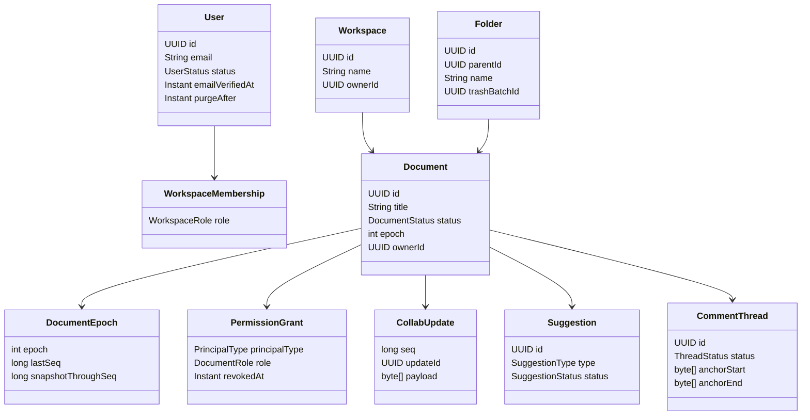
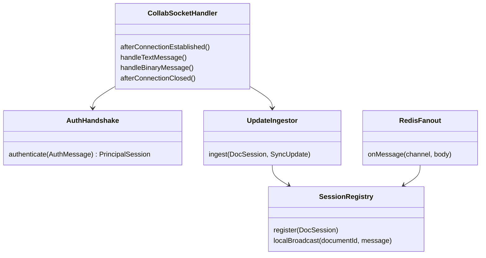
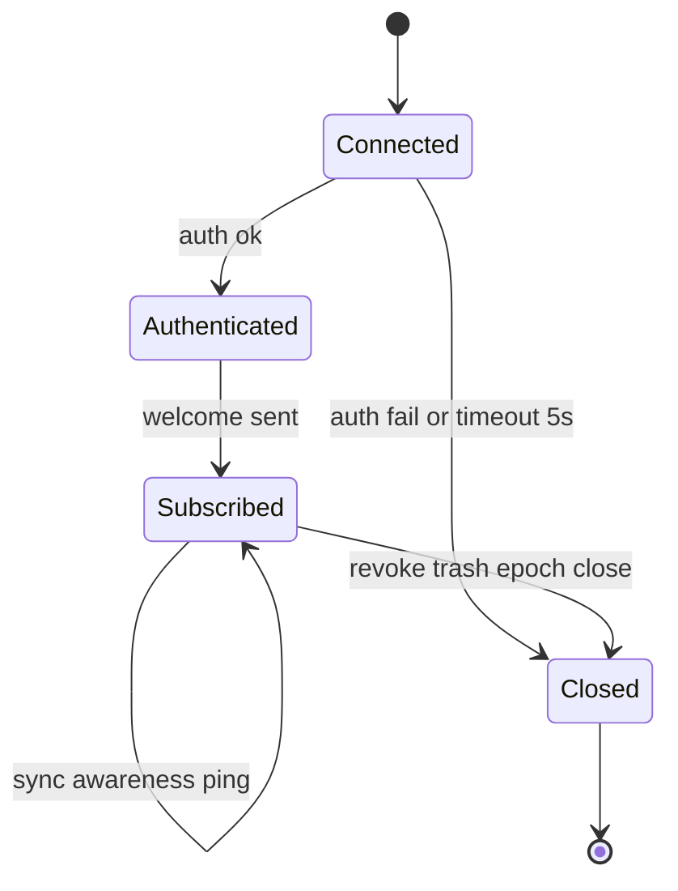
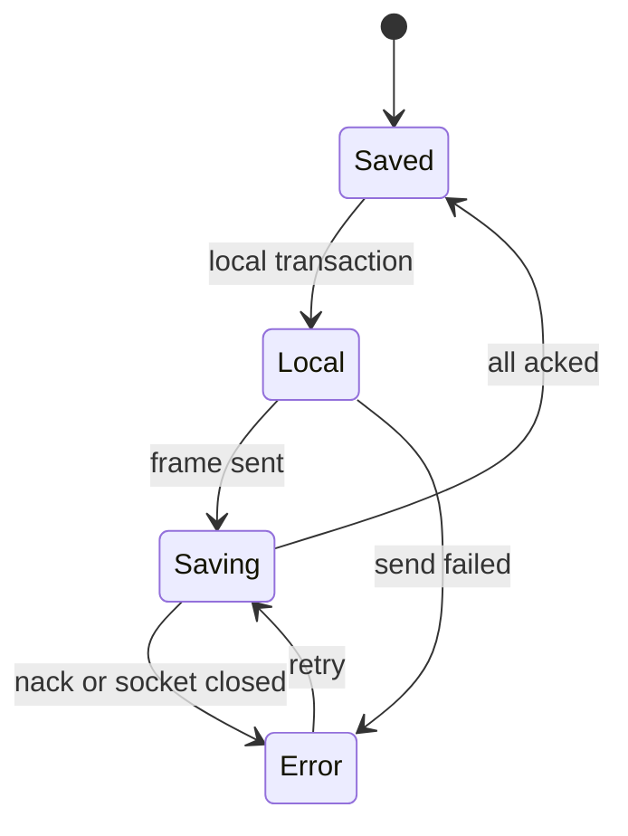
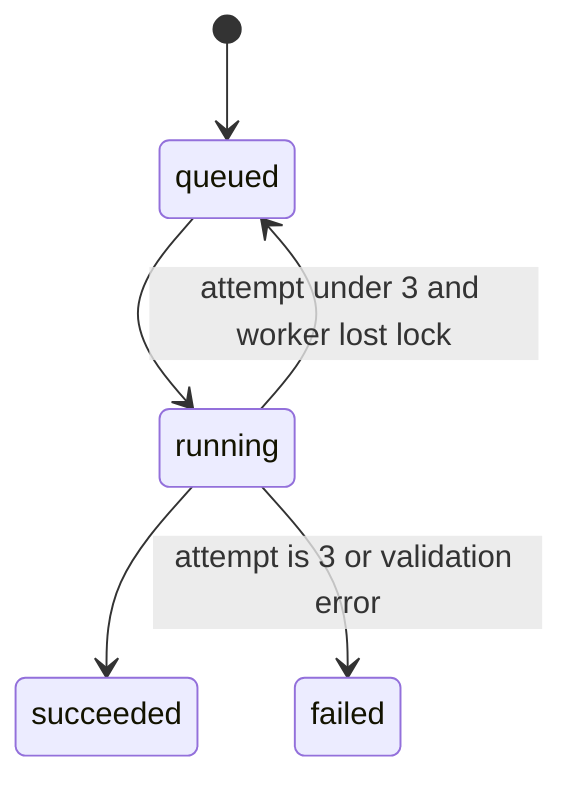
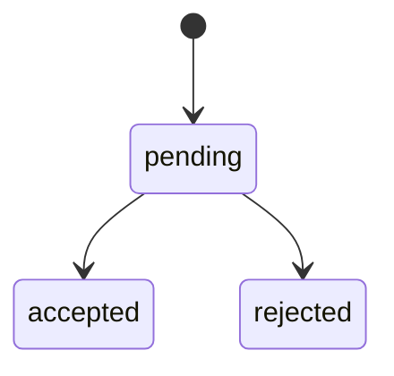
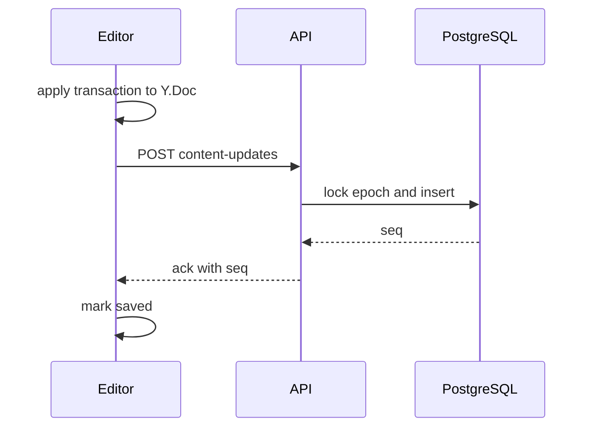
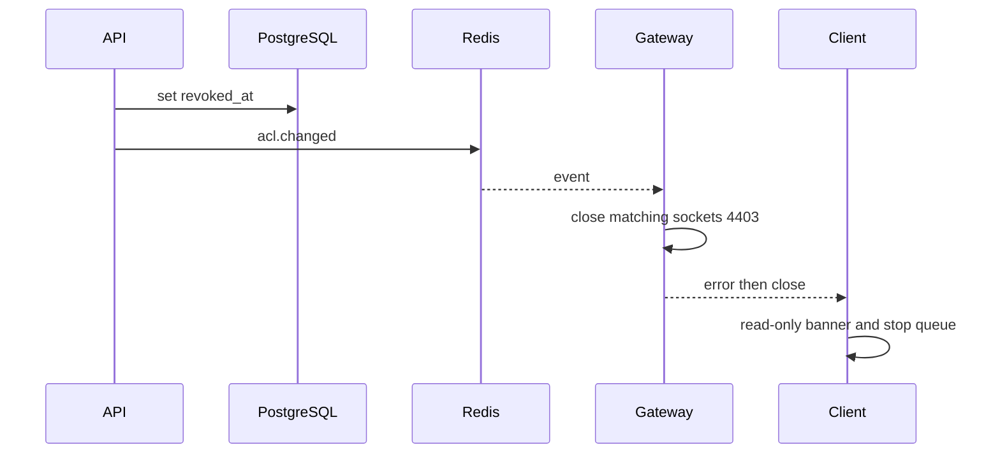

# CollabDocs Low-Level Design

| Field | Value |
| --- | --- |
| Audience | Engineers implementing services |
| Depends on | [HLD](HLD.md), [SRS](../01-product/SRS.md) |
| Related | [Database](../03-data/DATABASE_DESIGN.md), [API](../04-api/API_SPECIFICATION.md), [Protocol](../04-api/COLLABORATION_PROTOCOL.md) |

Examples in this document are design contracts. They are not a claim that the classes already exist in the repository.

## 1. Module dependency rules

```text
collabdocs-common  <- collabdocs-api
                   <- collabdocs-collab
                   <- collabdocs-worker
```

`common` contains permission evaluation, error types, correlation ids, JWT verification, and DTO records that cross process boundaries. It does not depend on Spring Web. `api`, `collab`, and `worker` do not depend on each other. They communicate through PostgreSQL and Redis.

The compactor is not a Maven module. It may not import Java types. Its JSON contract is in section 8.

Frontend code may not import server code. Shared knowledge is this documentation and the OpenAPI file.

## 2. Domain model



Invariants:

- `documents.owner_id` equals the user id of the single grant with role `owner` and `revoked_at is null`.
- `document_epochs.epoch` equals `documents.epoch` for the active row.
- `collab_updates.seq` is unique per `(document_id, epoch)` and strictly increasing.
- A suggestion status moves only from `pending` to `accepted` or `rejected`.
- `collab_updates.payload` length is between 1 and 262144 bytes.

## 3. Permission evaluation

Class `com.collabdocs.common.authz.PermissionService`.

```text
EffectiveRole resolve(Principal principal, UUID documentId)
```

Algorithm:

1. Load the document. If missing, return empty.
2. If the caller's user id equals a direct grant, consider that role.
3. If a pending invite email matches the verified email, ignore it until accepted.
4. If workspace membership role is `admin` or `owner` and `WORKSPACE_ADMIN_IMPLICIT_ACCESS` is true, consider `editor` plus share power.
5. Return the maximum role, or empty.

```text
void require(Principal principal, UUID documentId, DocumentRole minimum)
```

Throws `ForbiddenException` when the document exists and the caller has any grant or is a workspace member who can see the workspace document list entry. Throws `NotFoundException` when the caller should not learn the id exists. The list endpoints never return hidden ids, so `404` on a guessed id is the common case.

Share power (`canAdminister`) is true for the document owner and for workspace admin or owner.

The same class is used in `api`, `collab`, and `worker`. Agents must not reimplement role ordering.

Role order: `viewer = 1`, `commenter = 2`, `editor = 3`, `owner = 4`.

## 4. API service operations

Controllers are thin. They map HTTP to a command object and a service method. Transactions sit on the service method.

### 4.1 AuthService

| Method | Inputs | Outputs | Failure |
| --- | --- | --- | --- |
| `register` | email, display name, password | access token, user, sets refresh cookie via port | `EmailTakenException` |
| `verifyEmail` | raw token | user | `TokenInvalidException` |
| `login` | email, password, user agent, ip | session result | `InvalidCredentialsException`, `AccountDisabledException` |
| `refresh` | raw refresh token | new session result | `SessionReusedException` revokes family |
| `logout` | session id | void | |
| `logoutAll` | user id | void | |
| `forgotPassword` | email | always void | |
| `resetPassword` | raw token, new password | void | `TokenInvalidException` |
| `scheduleDeletion` | user id, password, confirmation | void | `WorkspaceOwnershipException` |

Password hashing is `PasswordHasher`, Argon2id. Tokens for email are 32 random bytes, stored as SHA-256 hex.

### 4.2 DocumentService

| Method | Notes |
| --- | --- |
| `create` | Inserts document, owner grant, epoch row, empty snapshot |
| `rename` | Editor. Title validation |
| `move` | Same workspace |
| `duplicate` | New id, copy latest snapshot bytes, copy attachment objects |
| `trash` | Sets status, publishes `document.trashed` after commit |
| `restore` | Clears trash if `purge_after` is future |
| `purge` | Owner. Deletes dependents. Idempotent if already gone |
| `recordOpen` | Upsert recent row |

Empty snapshot bytes are produced once by the compactor during image build and checked in as a resource `empty-doc-v1.bin`, so the API does not run Yjs. The file is the Yjs encoding of a document whose fragment `prosemirror` is a single empty paragraph. A test in the compactor package asserts that decoding it yields that structure. If the schema version changes, regenerate the file in the same change.

### 4.3 ContentUpdateService

Used by V1 HTTP autosave and by the gateway.

```text
Ack append(AppendCommand cmd)
```

`AppendCommand` fields: `documentId`, `actorId`, `clientId`, `updateId`, `epoch`, `payload`, `intent` (`edit` or `suggest`).

Transaction:

1. `SELECT` document and epoch `FOR UPDATE` on `document_epochs`.
2. If epoch mismatches, throw `StaleEpochException`.
3. If document status is not `active`, throw `DocumentNotEditableException`.
4. Insert update. On conflict, return the existing seq as a duplicate ack.
5. Increment `last_seq`.
6. Commit.

After commit, `CollabEventPublisher` publishes the update. The HTTP API also publishes so a future open socket receives HTTP-originated updates.

Invariant: this method is the only writer of `collab_updates`.

### 4.4 ShareService

`grant`, `changeRole`, `revoke`, `createLink`, `revokeLink`, `redeemLink`, `transferOwnership`, `requestAccess`, `decideAccess`.

`transferOwnership` locks the document row, verifies the caller is owner, inserts or updates the target grant to owner, downgrades the previous owner to editor, updates `documents.owner_id`, writes audit, all in one transaction.

### 4.5 CommentService

`createThread`, `reply`, `edit`, `delete`, `resolve`, `reopen`.

Anchors are opaque bytes supplied by the client, maximum 1024 bytes each. The server does not interpret them. It checks that the caller may comment and that the quoted text length is within limits.

### 4.6 SuggestionService

`accept`, `reject`, `acceptAll`, `rejectAll`.

Each method locks the suggestion row with `UPDATE ... WHERE status = 'pending' RETURNING *`. Zero rows means `SuggestionResolvedException`. The method then calls `ContentUpdateService.append` with the Yjs update produced by the client. The client builds the accept update because it holds the Y.Doc. The server does not synthesize ProseMirror steps.

Contract for accept:

- Client sends `POST .../suggestions/{id}/accept` with `{ "updateId", "clientId", "epoch", "payloadBase64" }`.
- Server verifies the suggestion is pending and the caller is an editor.
- Server appends the payload and marks the suggestion accepted in the same database transaction.
- If the payload is empty, reject the request. The server cannot prove the payload matches the suggestion id. V3 tests use the compactor in the test suite to apply the update and assert the mark is gone. Production accepts the editor's update and records the status. A hostile editor can already edit the document directly. The status row is bookkeeping for the review UI. Commenters cannot call accept.

`acceptAll` is repeated single accepts in one HTTP call, one transaction, failing the whole call if any append fails.

### 4.7 VersionService

`list`, `nameCurrent`, `preview`, `compare`, `restore`.

`nameCurrent` inserts a job-like request row `snapshot_requests` with `kind = named` and waits up to 5 seconds for the compactor. If the snapshot is not ready, the API returns `202` with the request id. The client polls `GET /versions`. For the synchronous path used in tests, the compactor is running.

`restore`:

1. Lock document.
2. Load the snapshot bytes for the version.
3. Increment epoch.
4. Insert a new `document_epochs` row, `last_seq = 0`, `snapshot_through_seq = 0`.
5. Insert `document_snapshots` for the new epoch with those bytes and `through_seq = 0`.
6. Audit.
7. After commit, publish `document.restored`.

### 4.8 ExportJobService

`create` inserts `export_jobs` and `XADD` the stream. Idempotency key unique on `(requested_by, idempotency_key)`.

Worker `ExportProcessor.handle`:

1. Claim job by setting `running` if `queued`.
2. Re-check reader permission.
3. Call compactor `/internal/project`.
4. Render.
5. Put object `exports/{jobId}`.
6. Set `succeeded` and object key.
7. On exception, increment attempts. At 3, set `failed`.

## 5. Collaboration gateway classes



`DocSession` fields: `connectionId`, `userId`, `documentId`, `role`, `epoch`, `clientId`, `intent`, `lastClientHeartbeat`.

`UpdateIngestor` delegates persistence to `ContentUpdateService` in `common` so HTTP and WebSocket share one transaction implementation. The service lives in `common` as an interface plus a Spring implementation in a small `collabdocs-persistence` package if splitting the Spring Data dependency out of `common` is cleaner. Chosen layout: `collabdocs-persistence` module depended on by `api` and `collab`, containing `ContentUpdateService`. `common` stays free of JPA. Update the module diagram:

```text
common <- persistence <- api
                     <- collab
                     <- worker
```

`worker` uses persistence for job rows. `worker` does not append collaborative updates except by calling the same `ContentUpdateService` when an import installs the first snapshot. Import writes a snapshot row, not a stream of user updates.

### 5.1 Connection state machine



Unauthenticated sockets that do not send `auth` within 5 seconds are closed with `4401`.

### 5.2 Read loop and backpressure

Each session has an outbound queue capped at 200 messages or 4 MB, whichever comes first. If the queue is full, the gateway closes that socket with `4429`. The client reconnects and loads the tail. The gateway does not drop individual document updates while keeping the socket open, because a gap would force a more complex gap-fill protocol. Close and resync is the gap-fill.

Inbound content updates are limited to 20 per second per connection, bursting to 40. Excess updates are rejected with an error frame `RATE_LIMITED` and are not persisted. The client must undo or retry later. Typing rarely hits this. Paste of a huge replacement might. The client should send paste as one update.

## 6. Repository abstractions

Spring Data repositories stay inside `collabdocs-persistence` and `api`. Services depend on interfaces:

- `UserRepository`
- `SessionRepository`
- `DocumentRepository`
- `EpochRepository`
- `UpdateRepository`
- `PermissionRepository`
- `SnapshotRepository`
- `Outbox` is not used. Post-commit hooks publish Redis messages. If publish fails, clients still recover by resync because the row is committed. The origin may miss `sync.ack`. It retries the same `updateId` and receives a duplicate ack. Implement publish inside a transaction synchronization `afterCommit`.

## 7. Error model

```text
CollabDocsException
  UnauthorizedException      -> 401
  ForbiddenException         -> 403
  NotFoundException          -> 404
  ConflictException          -> 409
  ValidationException        -> 400
  GoneException              -> 410
  PayloadTooLargeException   -> 413
  UnprocessableException     -> 422
  RateLimitException         -> 429
  DependencyException        -> 503
```

WebSocket close codes:

| Code | Meaning |
| --- | --- |
| 4401 | Not authenticated |
| 4403 | Not allowed or revoked |
| 4409 | Stale epoch |
| 4413 | Payload too large |
| 4429 | Backpressure or rate limit |
| 4500 | Internal error |

Application close codes are in the private-use range. The JSON error frame is sent before close when the socket is still open.

## 8. Compactor HTTP contract

Base URL: `http://compactor:8083`. Header: `Authorization: Bearer ${INTERNAL_TOKEN}`.

### POST /internal/project

Request:

```json
{
  "schemaVersion": 1,
  "snapshotBase64": "...",
  "updatesBase64": ["..."]
}
```

Response:

```json
{
  "schemaVersion": 1,
  "canonicalJson": {},
  "acceptedText": "Hello",
  "wordCount": 1,
  "warnings": []
}
```

`canonicalJson` is the ProseMirror document with suggestion marks still present. `acceptedText` applies the projection rules from `FR-EDIT-026`.

### POST /internal/encode

Request:

```json
{ "schemaVersion": 1, "canonicalJson": {} }
```

Response:

```json
{ "snapshotBase64": "...", "byteLength": 120 }
```

### POST /internal/compact

Used by the compactor's own scheduler, not by other services. External services do not call it. The scheduler is in-process. This endpoint exists for tests.

Failure returns `422 SCHEMA_INVALID` or `500`. Callers do not retry `422` without a schema fix.

## 9. Frontend module design

| Module | Responsibility |
| --- | --- |
| `src/api/client.ts` | Fetch wrapper, access token memory, refresh single-flight, correlation header |
| `src/auth/` | Login, register, session bootstrap |
| `src/documents/` | Lists, folders, trash |
| `src/editor/schema.ts` | Tiptap extensions matching `FR-EDIT-001` |
| `src/editor/CollabEditor.tsx` | Y.Doc lifecycle |
| `src/editor/saveStatus.ts` | Maps ack set to `local`, `saving`, `saved`, `error` |
| `src/collab/connection.ts` | Socket, backoff, outbound queue |
| `src/collab/protocol.ts` | Encode and decode frames |
| `src/comments/` | Threads and anchors |
| `src/suggestions/` | Mode and accept/reject |
| `src/versions/` | History panel |

Rules:

- Components do not call `fetch` directly.
- The Y.Doc is created in `CollabEditor` and destroyed on unmount or epoch change.
- Save status reads the outbound map: an update is `saving` after send and `saved` after ack. If any update is unacked, the document is not saved.

## 10. State machines

### 10.1 Save status



### 10.2 Export job



### 10.3 Suggestion



## 11. Transaction boundaries

| Operation | Boundary |
| --- | --- |
| Register | User, workspace, membership, verification token |
| Refresh reuse detection | Revoke all sessions in family |
| Create document | Document, grant, epoch, snapshot |
| Append update | Epoch counter and update row |
| Transfer owner | Grants and document owner column |
| Trash folder | Subtree status and `trash_batch_id` |
| Accept suggestion | Suggestion row and update row |
| Restore | New epoch row and new snapshot row |
| Export success | Job row only. Object upload happens before the transaction that sets `succeeded`. If the transaction fails, the sweeper may upload again to the same key |

Do not hold a database transaction while uploading to object storage or while calling the compactor, except the short accept path which does not call the compactor.

## 12. Concurrency control

- Epoch allocation and seq allocation use row locks on `document_epochs`.
- Suggestion resolution uses a conditional update.
- Refresh rotation uses `UPDATE refresh_tokens SET revoked_at = now() WHERE id = ? AND revoked_at IS NULL RETURNING *`. One winner. The loser is treated as reuse if the presented token is not the current token.
- Compaction uses Redis lock TTL 60 seconds, renewed every 20 seconds.
- Job claim uses `UPDATE export_jobs SET status = 'running' WHERE id = ? AND status = 'queued'`.

Optimistic locking via a version column is additionally used on `documents` for rename versus trash races. Title updates include `WHERE version = :version`. Conflict returns `409`.

## 13. Design patterns

| Pattern | Where | Why |
| --- | --- | --- |
| Ports and adapters | Controllers, `PasswordHasher`, `ObjectStore`, `EventPublisher` | Tests replace Redis and S3 |
| Transaction script on services | Service methods | The workflows are procedural and short. A heavy domain-event bus is not needed |
| Conditional update | Suggestions and job claim | Prevents double resolution |
| Idempotency key | Updates and export create | Retries are expected |
| Outbound queue | Gateway and browser | Disconnects happen |

A generic repository framework beyond Spring Data is not introduced.

## 14. Sequence: V1 autosave



## 15. Sequence: permission revoke



## 16. Failure behavior summary

| Condition | Result |
| --- | --- |
| Duplicate `updateId` | `200` or ack with `duplicate: true` and original seq |
| Old epoch | `409 STALE_EPOCH` or close `4409` |
| Viewer sends edit | `403` or close `4403` |
| Payload over 256 KB | `413` |
| PostgreSQL down | `503`, no ack |
| Redis down after commit | Ack still sent on the origin connection. Other instances miss fan-out until resync |
| Compactor down | Editing and ack continue. Named version request stays `202` |
| Clock skew over 60 seconds | JWT rejected, user must refresh. Refresh does not use the access token |

## 17. Logging and correlation

`CorrelationFilter` reads `X-Correlation-Id` or generates a ULID. It is stored in MDC. The gateway generates one per connection if the auth message does not include one. The id is returned on every error body and on `welcome`.

## 18. Configuration keys

Shared environment keys are listed in `.env.example` and [DEVOPS](../08-devops/DEVOPS.md). Services fail startup if `DATABASE_URL`, `REDIS_URL`, or `JWT_PUBLIC_KEY` is missing. The API additionally requires `JWT_PRIVATE_KEY`. The compactor requires `INTERNAL_TOKEN` and `DATABASE_URL`.
