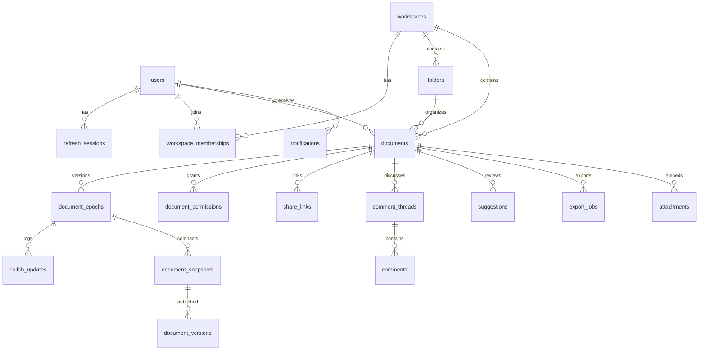

# CollabDocs Database Design

| Field | Value |
| --- | --- |
| Audience | Backend and persistence agents |
| Depends on | [SRS](../01-product/SRS.md), [LLD](../02-architecture/LLD.md) |
| Physical migration | [V1__init.sql](../../db/migration/V1__init.sql) |
| Flyway config | [flyway.conf](../../db/flyway.conf) |

The migration file is the normative column list. This document explains ownership, why each store exists, retention, and how transactions use the tables. If this narrative and the SQL disagree, the SQL and a later Flyway version win, and this document must be updated in the same change.

## 1. Store boundaries

| Data | System of record | Notes |
| --- | --- | --- |
| Accounts, sessions, workspaces, folders, documents, grants, comments, suggestion status, jobs, audit | PostgreSQL | See migration |
| Yjs updates | PostgreSQL `collab_updates.payload` | Opaque bytes, max 256 KB |
| Snapshots at or under 512 KB | PostgreSQL `document_snapshots.state` | `bytea` |
| Snapshots over 512 KB, avatars, attachments, export files, import uploads | Object storage | Key referenced by a row |
| Presence, session denylist, rate limits, pub/sub, job streams, compaction locks | Redis | Loss is recoverable |
| Offline editor queue | Browser IndexedDB | Not a server store |

Redis keyspace:

| Key | TTL | Value |
| --- | --- | --- |
| `denylist:session:{sessionId}` | Remaining access-token life, max 15 minutes | `1` |
| `presence:{documentId}` | Hash field per connection, field TTL is refreshed by rewriting the hash and setting key TTL 30 seconds | JSON awareness |
| `ratelimit:{route}:{subject}` | Window length | Counter |
| `lock:compact:{documentId}` | 60 seconds | Compactor instance id |
| Channel `collab:doc:{documentId}` | None | Committed update envelope |
| Channel `acl:doc:{documentId}` | None | Permission change |
| Stream `jobs:export` | Trimmed to 10000 | Job id |
| Stream `jobs:import` | Trimmed to 10000 | Job id |
| Stream `jobs:mail` | Trimmed to 10000 | Mail payload |

Presence is best-effort. The database does not store cursors.

## 2. Identifier and time rules

- Primary keys that leave the server are UUID values generated by the application as UUIDv7, stored in `uuid`.
- `collab_updates.id` and `audit_events.id` are `bigserial` and are not used as public ids. Public update identity is `(documentId, clientId, updateId)`.
- Timestamps are `timestamptz` in UTC.
- Soft delete uses `deleted_at`, `revoked_at`, or a `status` column. Hard delete is reserved for purge.

## 3. Entity relationships



## 4. Table notes

### users

Owns credentials and profile. `password_hash` is nullable so a future OAuth-only user can exist. `email` is unique across all statuses except a purged account, whose email is rewritten to `deleted+{id}@invalid.collabdocs.local` before the address can be registered again. Status `deleted` is the terminal anonymized row. Comments keep `author_id` pointing at that row.

### refresh_sessions

One row is the current token in a family when `revoked_at` is null. Rotation revokes the presented row and inserts a new row with the same `family_id`. Reuse of a revoked token's hash revokes every row in the family.

### workspaces and workspace_memberships

A personal workspace is created in the registration transaction. The owner membership role is `owner`. `link_sharing` is the workspace policy from BR-SHARE-002.

### folders

Adjacency list via `parent_id`. Depth is enforced in `FolderService` by walking parents up to 20, inside the same transaction that inserts the folder, with `SELECT ... FOR UPDATE` on the parent. A cycle check walks to the root. Trashing sets `trash_batch_id` on the folder and every descendant document and folder.

### documents

Metadata only. No JSON body column. `epoch` is the current collaborative timeline. `version` is an optimistic lock for metadata updates, not the content version. `word_count` is a cache written by the compactor and may lag by one compaction interval.

### document_epochs

One row per timeline. `last_seq` is the last assigned update sequence. `snapshot_through_seq` is the highest sequence included in the latest snapshot. Join loads the snapshot where `through_seq` is greatest and updates where `seq > snapshot_through_seq`.

Sequence assignment:

```sql
UPDATE document_epochs
SET last_seq = last_seq + 1
WHERE document_id = $1 AND epoch = $2
RETURNING last_seq;
```

The insert of `collab_updates` uses that value in the same transaction. Concurrent callers queue on the row lock.

### document_snapshots and document_versions

A snapshot is bytes. A version is a user-visible pointer, automatic or named. Named versions keep their snapshot from pruning. `state` and `state_object_key` are mutually exclusive.

### collab_updates

The durability record for editor changes. `UNIQUE (document_id, client_id, update_id)` implements idempotency. `UNIQUE (document_id, epoch, seq)` implements order. Payload is not parsed by PostgreSQL.

### document_permissions

Active grants are those with `revoked_at` null and (`expires_at` null or future). Partial unique indexes stop two active grants for the same user or the same invited email. Owner rows are not deleted. Transfer changes the role on the old owner row to `editor` and sets the new owner's role to `owner`.

### share_links

`token_hash` is SHA-256 of the raw token. Lookup uses the hash. Expired or revoked links fail in the service even if the row remains.

### comment_threads and comments

Anchors are client-produced Yjs relative positions. `anchor_state` is updated by the client through `PATCH` when it detects a detached anchor, and by restore handling. The server does not recompute Yjs positions.

### suggestions

Status bookkeeping. The characters live in the Yjs document. `payload` holds format-suggestion mark JSON when `type = format`.

### notifications

Per user. Payload is a small JSON object with `documentId`, `threadId`, or `jobId` as needed. No document bodies.

### audit_events

Append-only. The application database role receives `INSERT` and `SELECT` and does not receive `UPDATE` or `DELETE` on this table. That grant is in `V2__grants.sql` when roles are created for an environment. Local Compose uses one migration user for simplicity and the application still uses repository methods that only insert. Production roles are specified in [DEVOPS](../08-devops/DEVOPS.md).

### export_jobs and import_jobs

Status machines match the LLD. Idempotency is partial-unique so null keys are allowed.

### attachments

One row per uploaded image. `object_key` is `attachments/{documentId}/{attachmentId}`.

### document_stars and recent_documents

Per-user edges. Recent upserts `opened_at`. The read path deletes rows beyond the newest 50 for that user.

### templates

System templates have null `workspace_id`. The snapshot bytes live in object storage because they are static assets copied into new documents.

### snapshot_requests

Tracks a named-version request that the compactor fulfills.

## 5. Representative queries

Documents visible to a member, active, in a folder, newest first. Admin implicit access is applied in the service by skipping the permission join when the flag and role allow it. The ordinary member query:

```sql
SELECT d.id, d.title, d.updated_at, p.role
FROM documents d
JOIN document_permissions p
  ON p.document_id = d.id
 AND p.user_id = $user
 AND p.revoked_at IS NULL
 AND (p.expires_at IS NULL OR p.expires_at > now())
WHERE d.workspace_id = $workspace
  AND d.folder_id IS NOT DISTINCT FROM $folder
  AND d.status = 'active'
ORDER BY d.updated_at DESC, d.id DESC
LIMIT $limit;
```

Title search:

```sql
SELECT d.id, d.title
FROM documents d
JOIN document_permissions p
  ON p.document_id = d.id
 AND p.user_id = $user
 AND p.revoked_at IS NULL
WHERE d.workspace_id = $workspace
  AND d.status = 'active'
  AND d.title ILIKE '%' || $q || '%'
ORDER BY d.updated_at DESC
LIMIT 50;
```

The service escapes `\`, `%`, and `_` in `$q` before binding.

Tail after a snapshot:

```sql
SELECT seq, payload
FROM collab_updates
WHERE document_id = $doc AND epoch = $epoch AND seq > $through
ORDER BY seq ASC;
```

## 6. Transaction requirements

| Work | Isolation | Locks |
| --- | --- | --- |
| Append update | Read committed | `UPDATE document_epochs` row lock, then insert |
| Restore | Read committed | `SELECT documents FOR UPDATE` |
| Trash subtree | Read committed | Folder and descendant rows |
| Refresh rotation | Read committed | Update the presented session row |
| Accept suggestion | Read committed | Conditional suggestion update and epoch lock |

Long transactions must not include object-storage calls.

## 7. Retention

| Data | Policy |
| --- | --- |
| `collab_updates` covered by a later snapshot | Delete after 7 days |
| Automatic versions | Keep 90 days or the newest 100 per document, whichever is more. Never delete a snapshot still referenced by a named version |
| Named versions | Life of the document, or until the owner deletes the version record. Deleting a name does not restore older text |
| Trashed documents | Purge worker removes them 30 days after `trashed_at` |
| Refresh sessions | Delete rows expired or revoked for more than 30 days |
| Audit events | Keep 1 year in the primary table. Archival to object storage is a V5 job and is not required for correctness |
| Export objects | Delete 7 days after `finished_at` |
| Import uploads | Delete 7 days after the job finishes |
| Notifications | Delete read notifications after 90 days and unread after 180 days |
| Pending deletion users | Anonymize after `purge_after` |

Purge of a document deletes updates, snapshots, versions, comments, suggestions, permissions, links, stars, recents, attachments, and object keys in one application workflow. The database deletes are one transaction. Object deletes happen after commit and are retried.

## 8. Indexing and growth

Hot indexes are `collab_updates_tail_idx`, `documents_list_idx`, and `document_permissions_user_idx`. Title search uses `pg_trgm`. Agents add indexes in a new Flyway version with a stated query, not by editing `V1__init.sql` after it has been applied anywhere.

`collab_updates` is the fastest-growing table. Capacity numbers are in [NFR_AND_CAPACITY.md](../07-quality/NFR_AND_CAPACITY.md). Partitioning is not in V1. The partition key, if introduced, is `hash(document_id)` and requires an ADR change because primary-key and unique constraints must include the partition key.

## 9. Redis failure versus PostgreSQL failure

If Redis is empty and PostgreSQL is healthy, document bytes and permissions are intact. Users reconnect, presence repopulates, and jobs stuck in `queued` are re-added by the sweeper.

If PostgreSQL is empty and Redis is healthy, the product is down. Redis data is not a backup.

## 10. Sample content update row

The payload is binary. A hexadecimal illustration of shape, not a real Yjs frame:

```text
document_id: 018f2c1a-7c31-7b2a-9a10-2d5e6f7a8b9c
epoch: 1
seq: 42
client_id: 018f2c1b-1111-7b2a-9a10-2d5e6f7a8b9c
update_id: 018f2c1b-2222-7b2a-9a10-2d5e6f7a8b9c
intent: edit
byte_size: 86
```

## 11. Migration rules

- Flyway locations: `classpath:db/migration` and the repository `db/migration` mounted in Compose.
- Versions are sequential: `V2__...sql`, `V3__...sql`.
- Do not change a migration that has been applied on a shared environment. Add a new version.
- Each migration is wrapped by Flyway in a transaction unless it contains an explicit note that it is not transactional, such as `CREATE INDEX CONCURRENTLY`.
- Destructive column drops ship in two steps: stop writes in one release, drop in a later release.
