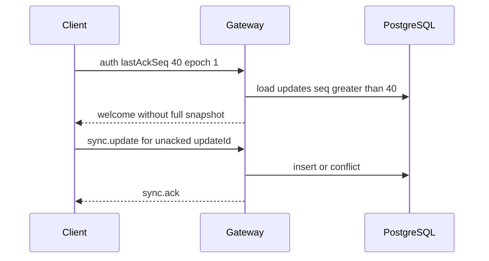
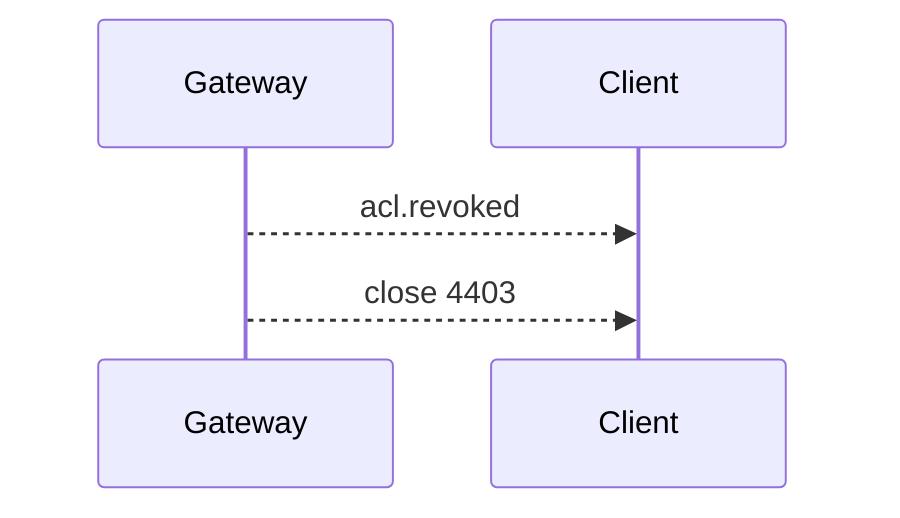

# CollabDocs Real-Time Collaboration Protocol

| Field | Value |
| --- | --- |
| Subprotocol | `collabdocs.v1` |
| Audience | Frontend and collaboration gateway agents |
| Depends on | [HLD](../02-architecture/HLD.md), [LLD](../02-architecture/LLD.md), [SRS](../01-product/SRS.md) |

## 1. Purpose

This protocol carries Yjs document updates and ephemeral awareness between browsers and the Java collaboration gateway. It is not the `y-websocket` wire format. Yjs update bytes inside `sync.update` frames are the bytes produced by `Y.encodeStateAsUpdate` or by an update event from a `Y.Doc`, unmodified.

V1 single-user autosave uses `POST /api/v1/documents/{id}/content-updates` with the same payload fields. A client that implements this protocol can switch transport without a second document model.

## 2. Connection

URL:

```text
wss://<host>/collab/v1
```

The browser sends:

```text
Sec-WebSocket-Protocol: collabdocs.v1
```

Nginx upgrades the connection and forwards it to `collab:8081`. The document id is not in the query string. It is in the first message, so access logs do not record it as a URL parameter and tokens are not in the URL.

The first client message must be `auth` and must arrive within 5 seconds.

## 3. Framing

Text frames are JSON objects with `type` and `payload`. Binary frames are reserved and are rejected with an error in v1. Yjs bytes are base64 inside JSON so intermediaries and logs can redact one field. The size limit applies to the decoded bytes, not the base64 length. Maximum decoded update size is 262144 bytes. Maximum text frame size is 400000 bytes.

Every client message may include `correlationId`. The server echoes it on the matching response.

## 4. Authentication and authorization

### 4.1 Client auth

```json
{
  "type": "auth",
  "payload": {
    "accessToken": "<jwt>",
    "documentId": "018f2c1a-7c31-7b2a-9a10-2d5e6f7a8b9c",
    "clientId": "018f2c1b-1111-7b2a-9a10-2d5e6f7a8b9c",
    "epoch": 1,
    "lastAckSeq": 40,
    "intent": "edit",
    "protocolVersion": 1
  }
}
```

`intent` is `edit`, `suggest`, or `view`.

The gateway:

1. Verifies the JWT signature and expiry with 60 seconds of skew.
2. Checks `denylist:session:{sid}`.
3. Resolves the document role.
4. Rejects `intent = edit` unless the role is editor or owner.
5. Rejects `intent = suggest` unless the role is commenter or higher.
6. Allows `intent = view` for viewer or higher.
7. If `epoch` is older than the database epoch, it still authenticates and the welcome contains the new epoch so the client can reset. It does not apply queued old-epoch updates.

Failure closes the socket after an error frame.

### 4.2 Welcome

```json
{
  "type": "welcome",
  "payload": {
    "connectionId": "018f2c1c-3333-7b2a-9a10-2d5e6f7a8b9c",
    "documentId": "018f2c1a-7c31-7b2a-9a10-2d5e6f7a8b9c",
    "epoch": 1,
    "schemaVersion": 1,
    "role": "editor",
    "snapshotBase64": "AAEC",
    "throughSeq": 40,
    "updates": [{ "seq": 41, "payloadBase64": "AQID" }],
    "correlationId": "01JABC"
  }
}
```

If the client sent `lastAckSeq`, the server may omit the snapshot when `lastAckSeq >= throughSeq` and send only updates with `seq > lastAckSeq`. If `lastAckSeq` is ahead of the server, the server ignores it and sends the full welcome. The client replaces local state when `epoch` differs from the epoch stored with IndexedDB.

After welcome, the client applies snapshot then updates in `seq` order, then sends any outbound updates still unacked.

## 5. Incremental updates

### 5.1 Client to server

```json
{
  "type": "sync.update",
  "payload": {
    "updateId": "018f2c1b-2222-7b2a-9a10-2d5e6f7a8b9c",
    "epoch": 1,
    "intent": "edit",
    "payloadBase64": "AAECAw=="
  }
}
```

The gateway persists, then replies only to the sender:

```json
{
  "type": "sync.ack",
  "payload": { "updateId": "018f2c1b-2222-7b2a-9a10-2d5e6f7a8b9c", "epoch": 1, "seq": 42, "duplicate": false }
}
```

Peers receive:

```json
{
  "type": "sync.apply",
  "payload": { "seq": 42, "epoch": 1, "actorId": "018f2c1a-2222-7b2a-9a10-2d5e6f7a8b9c", "payloadBase64": "AAECAw==" }
}
```

The origin does not receive `sync.apply` for its own update. It already applied the change locally. If a duplicate `updateId` arrives, the ack sets `duplicate: true` and peers are not notified again.

### 5.2 Ordering

`seq` is the server order used for persistence and for join tails. Yjs convergence does not depend on that order among updates that all get applied. Clients still apply `sync.apply` messages in `seq` order. If a client sees a gap, it sends `sync.catchup`.

```json
{ "type": "sync.catchup", "payload": { "epoch": 1, "afterSeq": 41 } }
```

The server responds with `sync.apply` messages for `seq > afterSeq`, at most 500 per response, then a `sync.catchup.page` with `done: false` if more remain.

### 5.3 Negative acknowledgement

```json
{
  "type": "sync.nack",
  "payload": { "updateId": "018f2c1b-2222-7b2a-9a10-2d5e6f7a8b9c", "code": "STALE_EPOCH", "message": "Reload the document." }
}
```

The client does not delete local characters on nack except for `PAYLOAD_TOO_LARGE` and `FORBIDDEN`, where it reloads from the latest welcome if it cannot undo the producing transaction.

## 6. Awareness

Awareness is not persisted in `collab_updates`.

```json
{
  "type": "awareness",
  "payload": {
    "anchor": 12,
    "head": 18,
    "displayName": "Priya",
    "color": "#1D4ED8"
  }
}
```

The gateway attaches `userId` and `connectionId` from the session. It writes Redis presence and publishes on the document channel with a message type `awareness` that other gateways forward. Clients replace the awareness state for that `connectionId`.

`anchor` and `head` are ProseMirror positions in the sender's current document. They are hints. If a remote position does not map, the cursor is hidden until the next awareness message. They are not Yjs relative positions because they are ephemeral and refreshed several times per second.

Awareness is limited to 4 messages per second per connection. Extras are dropped, not nacked.

## 7. Heartbeats

The client sends `{ "type": "ping", "payload": { "ts": 1710000000000 } }` every 15 seconds.

The server replies `{ "type": "pong", "payload": { "ts": 1710000000000 } }`.

If the server receives no client frame for 45 seconds, it closes the socket with `1001`. Presence TTL is 30 seconds, refreshed on ping and on awareness.

## 8. Server push events

| type | When |
| --- | --- |
| `document.restored` | Epoch changed. Payload `{ epoch, snapshotBase64, throughSeq }`. Client destroys the Y.Doc and loads this state. |
| `document.trashed` | Document trashed. Close follows with `4403`. |
| `acl.revoked` | This user lost access. Close follows with `4403`. |
| `acl.role` | Role changed. Payload `{ role }`. Client may need to stop sending edits. |

## 9. Errors

```json
{ "type": "error", "payload": { "code": "FORBIDDEN", "message": "Viewers cannot edit.", "correlationId": "01J" } }
```

Codes: `UNAUTHENTICATED`, `FORBIDDEN`, `STALE_EPOCH`, `PAYLOAD_TOO_LARGE`, `RATE_LIMITED`, `INVALID_MESSAGE`, `SCHEMA_VERSION`, `INTERNAL`.

`SCHEMA_VERSION` means the server `schemaVersion` is greater than the client's supported version. The client shows an upgrade message and does not edit.

## 10. Termination

The client may send `{ "type": "bye" }` and then close. The server clears presence for that connection.

Close codes are listed in the LLD. Standard `1000` is a clean client close. `1001` is an idle timeout.

## 11. Validation

The gateway rejects a message when:

- JSON cannot be parsed.
- `type` is unknown.
- A required payload field is missing or the wrong type.
- `payloadBase64` does not decode.
- Decoded length is outside 1–262144.
- `epoch` is not the current epoch for `sync.update`.
- `intent` on the update exceeds the connection intent. A connection in `view` cannot send `edit`. A connection in `suggest` cannot send `edit`. An `edit` connection may send `suggest` only when accepting or rejecting, and those updates go through the REST suggestion endpoints, not the socket, in V3. The socket `intent` stays `edit` or `suggest` for the whole connection. Switching mode reconnects.

Invalid messages produce `error` and do not change the document. Ten invalid messages in a minute close the socket with `4400` mapped as `1008` policy violation if the platform cannot send 4400. The implementation uses `4400` for protocol abuse.

## 12. Backpressure

See LLD section 5.2. The client outbound queue holds at most 100 unacked updates. Further local edits still apply to the Y.Doc and the queue blocks the network task. If the queue stays full for 30 seconds, the UI shows save failed. The local document is not discarded.

## 13. Duplicates

Retries reuse `updateId`. The unique database key makes persistence idempotent. The client treats a duplicate ack as success.

`sync.apply` duplicates can happen if the client catchups while a pub/sub message arrives. Clients track applied `seq` values for the epoch and ignore repeats.

## 14. Persistence acknowledgement

`sync.ack` is sent only after PostgreSQL commit. There is no "received" ack. The UI state `saved` requires an ack for every locally produced update id currently in the document's pending set.

Fan-out failure after commit does not revoke the ack. Peers heal with catchup.

## 15. Mapping to Yjs

| Protocol field | Yjs concept |
| --- | --- |
| `snapshotBase64` | `Y.encodeStateAsUpdate(doc)` at compaction time |
| `sync.update.payloadBase64` | The `update` argument from `doc.on('update', update => ...)` |
| `sync.apply` | `Y.applyUpdate(doc, bytes, origin)` with an origin that the editor binding ignores for local undo capture as a remote change |
| Awareness | Not a Yjs update. A separate map keyed by `connectionId` |

The server does not implement Yjs sync step 1 and step 2 state-vector exchange. The snapshot plus ordered tail is the state-vector equivalent under the assumption that clients do not invent updates the server has not stored, except for their own unacked outbound queue. Those are resent by id.

This is a deliberate simplification versus `y-protocols/sync`. A client that was offline and generated updates still has them as complete Yjs updates. Applying the server snapshot from an empty doc and then the tail, then applying the client's unacked updates, converges if the unacked updates were created against a state that already contained the snapshot and tail the client had previously acked. The client must not apply the welcome snapshot on top of a doc that already contains newer local updates. The required client procedure:

1. Keep the local Y.Doc.
2. If `epoch` changed, replace the doc with the welcome snapshot and stop.
3. If `epoch` is unchanged, apply only tail updates whose `seq` is unknown. Do not reset the doc.
4. Resend unacked local updates.

The first connection in a browser session starts from an empty Y.Doc and applies the full welcome.

## 16. Sequence diagrams

Document open and concurrent editing are in the HLD. Reconnect:



Permission loss:



## 17. Versioning

The subprotocol name is the version. `collabdocs.v2` may be added later. A gateway advertises only the versions it implements. Unknown `protocolVersion` in `auth` yields `INVALID_MESSAGE` and close.

Compatible changes inside v1: new server `type` values. Clients ignore unknown types. Incompatible changes: renaming fields, changing ack semantics, or changing snapshot encoding. Those require a new subprotocol.

## 18. Security notes

- The access token appears in the first text frame. Gateways log `type` and `documentId` and never log `accessToken` or `payloadBase64`.
- The gateway re-checks the denylist and role every 60 seconds.
- Viewers can observe content they are allowed to read. They cannot write.
- Update bytes are not executable. They are applied only inside Yjs on clients and the compactor.

## 19. Worked example

Two editors, empty document, epoch 1, snapshot through seq 0.

1. A inserts "Hi". Local Y.Doc updates. A sends `sync.update` with `updateId` U1.
2. Gateway stores seq 1 and acks A.
3. B, already welcomed, receives `sync.apply` seq 1 and shows "Hi".
4. B's socket drops before its own insert of "!" is acked.
5. B reconnects with `lastAckSeq` 0 if it never received an ack, or with the last ack it knows.
6. B resends the same `updateId` for "!".
7. Gateway stores seq 2. Both documents contain "Hi" and "!" in CRDT order, which for sequential inserts at the end is `Hi!` when B typed at the end after applying seq 1. If B typed offline against the original empty doc, Yjs may order the inserts side by side. That result is accepted convergence, not last-write-wins.
