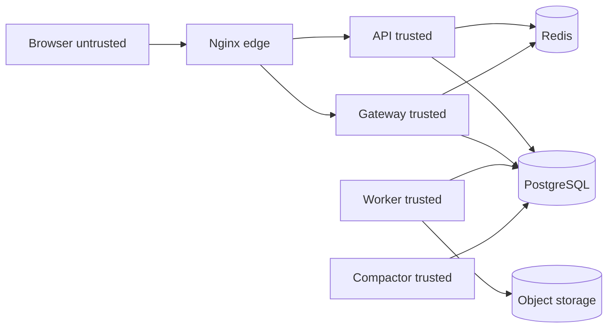

# CollabDocs Security and Threat Model

| Field | Value |
| --- | --- |
| Audience | Security, backend, and QA agents |
| Depends on | [SRS](../01-product/SRS.md), [HLD](../02-architecture/HLD.md) |
| Related | [DEVOPS](../08-devops/DEVOPS.md) |

## 1. Assets

| Asset | Why it matters |
| --- | --- |
| Document bytes and snapshots | User content |
| Comments and suggestions | Private review discussion |
| Password hashes and refresh tokens | Account takeover |
| Access tokens | Short-lived impersonation |
| Share link tokens | Grant creation |
| Avatars, attachments, exports | User files, some untrusted |
| Audit log | Accountability |
| JWT signing key and `INTERNAL_TOKEN` | Trust between services |
| Database and object storage credentials | Full data access |

## 2. Trust boundaries



The browser is untrusted. Nginx is the only public ingress. Compactor, PostgreSQL, Redis, MinIO, and the worker are reachable only on the Docker network in production. The internal token is a shared secret on that network. Compromise of the network is treated as compromise of the compactor.

The SPA is not a trust boundary for authorization. Hiding a button is not a control.

## 3. Threat actors

| Actor | Capability |
| --- | --- |
| Anonymous internet user | Can call public routes and open sockets |
| Authenticated user | Can call APIs as themselves and attempt id guessing |
| Collaborator who lost access | May still hold an access token until expiry |
| Malicious document content | HTML, DOCX, images crafted to exploit parsers |
| Compromised dependency | Build or runtime library |
| Operator with host access | Can read containers and volumes |

A nation-state physical attacker and host kernel exploits are out of scope beyond disk encryption and patching.

## 4. Attack scenarios and mitigations

| ID | Scenario | Mitigation | Residual risk |
| --- | --- | --- | --- |
| T-01 | Credential stuffing | Rate limit login, generic 401, Argon2id | Distributed low-rate attacks need later anomaly detection |
| T-02 | Refresh token theft from a device | Rotation and family revocation on reuse, HttpOnly cookie | Theft plus immediate use before the real client refreshes succeeds until reuse is detected |
| T-03 | Access token theft via XSS | Tokens in memory, strict HTML schema, CSP | A successful XSS during the token lifetime can call the API |
| T-04 | CSRF on refresh | `SameSite=Lax` and `X-CollabDocs-Request` | A bug that skips the header check would reopen CSRF on refresh |
| T-05 | IDOR on documents | Permission service on every route, tests for cross-user ids | A missed check on a new route |
| T-06 | WebSocket connect with a stolen token | Same JWT checks, denylist, role checks per update | Token valid for up to 15 minutes |
| T-07 | Revoked user keeps editing | ACL pub/sub and 60-second recheck | Up to 5 seconds target, 60 seconds if pub/sub is down |
| T-08 | Share link leaked | Hash at rest, expiry, revoke, policy cap on role | Anyone with the raw token can redeem until expiry |
| T-09 | Stored XSS through paste or import | Schema sanitizer, no arbitrary HTML, CSP | Unknown parser bug |
| T-10 | SSRF through imported images or links | Do not fetch remote URLs. Links are client navigation only | Users can still click a phishing link |
| T-11 | Malicious image decoder | Size and type sniff, dimension cap, re-encode not required in V1. V4 worker runs image decode in the worker process | Decoder vulnerability in the image library |
| T-12 | DOCX parser bomb | 20 MB cap, 2000 image cap, POI limits on expanding entities | A parser bug below the cap |
| T-13 | Export of a document the user can no longer read | Re-check at download | A race before the check returns data only if the check is skipped |
| T-14 | SQL injection | Parameterized queries only. No string-concatenated SQL in repositories | Native queries that violate the rule |
| T-15 | Log injection of tokens | Redact `authorization`, cookie, `accessToken`, `payloadBase64` | A new log statement that forgets the redaction list |
| T-16 | Privilege via workspace admin flag | Audited, configurable, documented as OQ-3 | Admins can read documents if the flag is on |
| T-17 | Compactor called from the internet | No Nginx route, bearer internal token | Network segmentation failure |
| T-18 | Mass registration | Rate limit and later captcha if abuse appears | Captcha is not in V1 |
| T-19 | Account enumeration on register | `409` on duplicate email does reveal registration. Forgot-password does not | Register enumeration is accepted so users can correct typos. Monitor spikes |
| T-20 | Backup theft | Encrypted volumes in production, restricted backup credentials | A holder of backup keys can read data |

## 5. Authentication detail

- Passwords: Argon2id, parameters in config, starting point memory 19456 KiB, iterations 2, parallelism 1. Pepper is not used. The hash includes its own salt.
- Access JWT claims: `iss=collabdocs`, `aud=collabdocs-api`, `sub` user id, `sid` session id, `email_verified` boolean, `iat`, `exp`, `jti`.
- Algorithm RS256. Reject `none` and any algorithm other than RS256.
- Private key only on `api`. Public key on `api`, `collab`, and `worker`.
- Keys are PEM in environment variables injected from a secret store in production and from `.env` locally. `.env` is not committed.
- Rotation: publish the new public key, start signing with the new private key, keep the previous public key for 15 minutes.

## 6. Authorization detail

Enforcement map:

| Operation | Check |
| --- | --- |
| REST metadata and content read | `PermissionService.require` at least viewer |
| Content update `edit` | Editor |
| Content update `suggest` | Commenter |
| Comment create | Commenter |
| Suggestion accept or reject | Editor |
| Share and purge | `canAdminister`, purge and transfer require owner as specified |
| WebSocket auth | Same service |
| Each `sync.update` | Role and intent and denylist |
| Export create and download | Viewer at that moment |
| Attachment read | Viewer |
| Attachment write | Editor |
| Internal compactor | `INTERNAL_TOKEN` constant-time compare |

Frontend checks mirror these so the UI can explain failures. They are not sufficient.

When access is revoked, the API publishes `acl.revoked`. The gateway closes sockets. The client shows "You no longer have access" and clears the in-memory Y.Doc for that document. IndexedDB for that document id is deleted.

## 7. Document privacy

- List and search queries join grants.
- Guessed document ids return 404 for strangers.
- Error messages do not include document titles the caller cannot see.
- Exports are stored under unguessable keys and downloaded through the API.
- Object storage buckets block public ACLs.

## 8. WebSocket security

- WSS in deployed environments.
- Origin check: the gateway allows origins listed in `ALLOWED_ORIGINS`.
- Max message size 400000 bytes, configured on the WebSocket container.
- Auth frame is not written to info logs.
- One user may hold at most 20 concurrent sockets. One user may hold one socket per document. A new socket for the same user and document replaces the old one.

## 9. Session management

Covered by ADR-009 and `FR-AUTH-005`. Logout writes the denylist. Password reset revokes families. Account disable revokes families.

## 10. XSS and content sanitization

CSP on the SPA:

```text
default-src 'self';
img-src 'self' blob:;
connect-src 'self' wss:;
style-src 'self' 'unsafe-inline';
script-src 'self';
object-src 'none';
base-uri 'self';
frame-ancestors 'none'
```

`unsafe-inline` for style is a known relaxation because the editor sets highlight colors as inline styles from an allow-list. Script inline is not allowed.

The editor does not use `innerHTML` with user strings. ProseMirror renders from the schema. Preview HTML from the worker is sanitized to the same tag allow-list: `p`, `h1`–`h6`, `ul`, `ol`, `li`, `blockquote`, `strong`, `em`, `u`, `s`, `code`, `a`, `table`, `thead`, `tbody`, `tr`, `th`, `td`, `img`, `hr`, `br`, `span`. Anchors require `href` with http, https, or mailto. Images require an attachment URL on this origin. `rel="noopener noreferrer"` is added on links.

## 11. Upload validation

- Sniff magic bytes.
- Enforce declared size before buffering the whole stream to disk. The API stores the upload to a temp object and then promotes it.
- Reject archives for avatars and attachments. DOCX is a zip and is accepted only on the import endpoint, which opens it with POI limits and does not extract entries to arbitrary paths.

## 12. Malware scanning

V1 does not claim malware scanning. The residual risk is accepted for a documentation and collaboration product that does not execute uploads. V5 adds an optional ClamAV sidecar for import objects. Infected jobs fail with `MALWARE_DETECTED` and the object is deleted. The scanner is not on the editor keystroke path.

## 13. Rate limiting and abuse

Limits are in the API specification. Implementation uses Redis `INCR` with expiry. If Redis is down, authentication routes fail closed with `503`. Document reads fail open only when the user already presented a valid token, and a metric `ratelimit_bypass_total` increments. Writes fail closed.

## 14. Encryption

- In transit: TLS 1.2 or newer at Nginx in staging and production. Compose development uses HTTP on localhost and this is called out in the README as a development exception.
- At rest: PostgreSQL volume and object storage rely on disk encryption provided by the deployment environment. Application-level field encryption is not used, because the server must read document bytes to sync and export.
- Backups: encrypted with a key that is not stored on the same volume as the backup.

## 15. Secret management

| Secret | Local | Production |
| --- | --- | --- |
| Database password | `.env` | Secret manager injected as env |
| JWT keys | `.env` PEM | Secret manager, rotated |
| `INTERNAL_TOKEN` | `.env` | Secret manager |
| MinIO or S3 keys | `.env` | Instance role preferred, keys if the provider requires them |
| SMTP password | Mailpit needs none | Secret manager |

`.env.example` contains empty placeholders. CI uses repository secrets, not the example file.

## 16. Audit logging

Actions: login success and failure, logout-all, password reset, permission grant and revoke, link create and revoke, ownership transfer, access request decision, export download, account deletion schedule, restore version, role change.

Audit rows include actor, action, target, timestamp, and metadata that does not contain document bodies or tokens. Failures to write an audit row for a security action fail the user-facing transaction.

## 17. Data retention and account deletion

Retention is in the database design. Account deletion follows PRD section 12. Backups may contain deleted content until the backup expires. The backup retention maximum is 30 days. The privacy notice must say that. Immediate purge from backups is not offered.

## 18. Dependency vulnerabilities

CI runs `mvn dependency-check` or OWASP dependency-check on a weekly schedule and `npm audit --omit=dev` for the compactor and web package locks. High and critical findings block release unless a documented exception with a review date is added to `docs/05-security/EXCEPTIONS.md`. That file does not exist until the first exception.

Images are pinned by digest in production manifests. Development Compose may use tags that are pinned in the file to minor versions.

## 19. Security testing

- Unit tests for role ordering and token reuse.
- API tests that a second user receives 404 for another user's document.
- WebSocket test that a viewer update is nacked and not stored.
- Test that import HTML with a script tag does not appear in the projected document.
- Test that an external image URL in HTML import is listed as dropped and is not requested. The test runs with an HTTP sink that fails the test if called.
- Dependency scan in CI.
- Threat model review when a new public route or a new content renderer is added.

## 20. Incident response

1. Declare an incident and assign an owner.
2. Contain: revoke signing key trust by rotating keys, set workspace `link_sharing=disabled` if links leaked, disable the user, or block the route at Nginx.
3. Preserve logs and audit rows. Do not purge first.
4. Eradicate the cause and add a regression test.
5. Notify affected users if document content or credentials were exposed. The legal standard is outside this document. The product must be able to list users with grants on a document and sessions used during a time window.
6. Write a short postmortem with the correlation ids and the control that failed.

Runbooks for operational failures are in [OBSERVABILITY.md](../08-devops/OBSERVABILITY.md).

## 21. Open security questions

- OQ-3 admin implicit access remains a product confirmation. The control is the feature flag and the audit row.
- Captcha and MFA are not required by the PRD. MFA would be a new ADR if a customer requires it.
- ClamAV is optional in V5, not a V1 claim.
