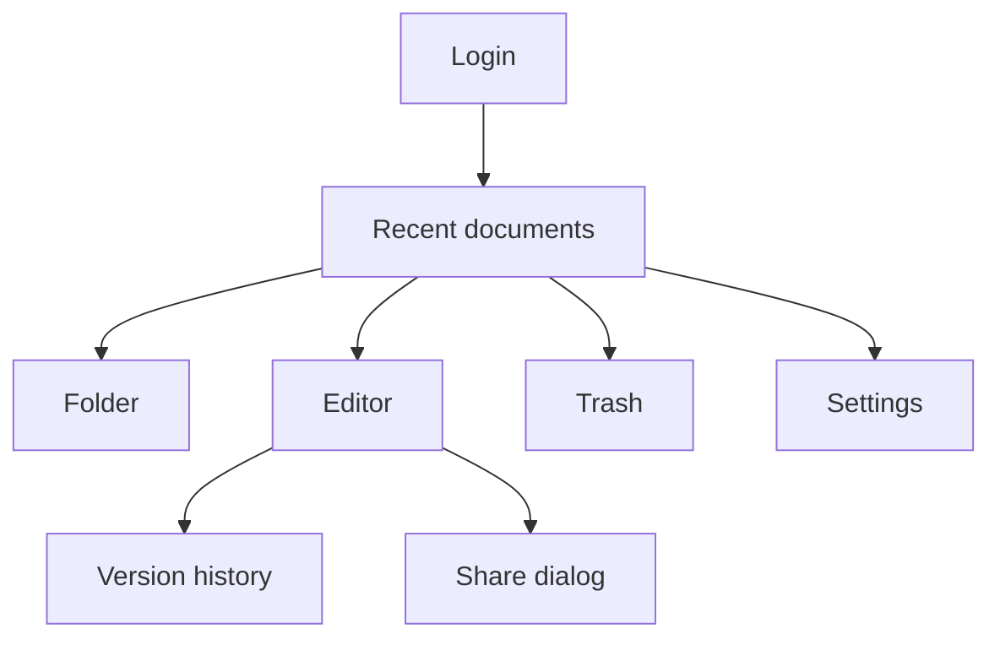

# CollabDocs Frontend Architecture and UI Specification

| Field | Value |
| --- | --- |
| Audience | Frontend agents |
| Depends on | [PRD](../01-product/PRD.md), [API](../04-api/API_SPECIFICATION.md), [Protocol](../04-api/COLLABORATION_PROTOCOL.md) |
| Stack | React 18, TypeScript, Vite, Tiptap, Yjs, TanStack Query, Zustand |

The production UI is static files. Visual design is original: a light neutral canvas, a single accent color, and no third-party word-processor branding.

## 1. Routes

| Path | Page | Auth |
| --- | --- | --- |
| `/login` | Login | Guest |
| `/register` | Register | Guest |
| `/forgot-password` | Request reset | Guest |
| `/reset-password` | Set new password, token query | Guest |
| `/verify-email` | Enter or consume token | User |
| `/` | Redirect to the personal workspace recent list | User |
| `/w/:workspaceId` | Recent documents | Member |
| `/w/:workspaceId/folder/:folderId` | Folder | Member |
| `/w/:workspaceId/starred` | Starred | Member |
| `/w/:workspaceId/trash` | Trash | Member |
| `/w/:workspaceId/search` | Search results, query `q` | Member |
| `/d/:documentId` | Editor | Document role |
| `/d/:documentId/history` | Version history beside a read-only preview | Viewer |
| `/settings` | Profile, sessions, deletion | User |
| `/share/:token` | Redeem link then open the document | User |

Unknown routes show a not-found page with a link home.



## 2. Page hierarchy

```text
AppShell
  SkipLink
  TopBar
    WorkspaceSwitcher
    SearchField
    NotificationButton
    AccountMenu
  Sidebar
    Recent
    Starred
    FolderTree
    Trash
  Outlet
EditorPage
  EditorTopBar
    TitleField
    SaveStatus
    PresenceList
    ShareButton
  Toolbar
  EditorCanvas
  SidePanel
    Comments or Outline or History
```

The document list does not mount the editor. Navigating away destroys the Y.Doc.

## 3. Component specifications

### 3.1 SaveStatus

Text and a polite live region.

| State | Label |
| --- | --- |
| `saved` | Saved |
| `local` or `saving` | Saving |
| `error` | Could not save. Retry |
| Offline queue exists | Saved on this device |

The control includes a retry button in `error`.

### 3.2 Toolbar

Buttons toggle marks and block types from `FR-EDIT-002` onward. Disabled buttons remain visible with `aria-disabled` and an explanation in a tooltip for permission, and are removed from the tab order when the role can never use them in this session. Viewer sessions show the toolbar as inactive and do not render mutating buttons.

Overflow: below 768 px, secondary items move into a "More" menu. Bold, italic, underline, and headings stay visible.

### 3.3 Share dialog

Modal. Lists grants. Owner sees invite field and link section. Non-owners see the list without edit controls. Focus traps. Escape closes. Submit errors stay inside the dialog.

### 3.4 Comments

Selection comment button appears for commenter and higher when the selection is non-empty. Threads render beside the canvas on wide screens and in a bottom sheet below 768 px. Detached threads show "Original text was removed" and the quoted text.

### 3.5 Suggestion mode

A segmented control: Editing, Suggesting. Suggesting is available to commenter and higher. Viewers do not see it. Pending inserts render with an underline and the author name. Pending deletes render with a strike and the author name. Color is paired with the words "Suggested insertion" in the accessible name.

### 3.6 Version history

List on the left, preview on the right. Restore asks for confirmation: "Replace the current document with this version? People who have it open will be moved to the restored version."

### 3.7 Document list

Rows show title, last edited time, and role. Empty folder copy: "No documents in this folder" and a create button when the user can create. Trash empty copy: "Trash is empty".

## 4. State management

| State | Home | Lifetime |
| --- | --- | --- |
| Access token | Module variable in `api/client.ts` | Tab memory. Not localStorage |
| Refresh | HttpOnly cookie | Browser |
| Server lists | TanStack Query | Cache keyed by workspace and folder |
| Y.Doc, connection, pending acks | React context on the editor page | Document route |
| Panels, menus | Zustand `uiStore` | Session |
| Offline Y.Doc | IndexedDB database `collabdocs`, store `docs`, key document id | V2 |

Query invalidation: document rename invalidates folder lists. Permission changes invalidate the document query.

## 5. API client

`api/client.ts` sends `Authorization`, `X-CollabDocs-Request`, and `X-Correlation-Id`. On `401`, it calls refresh once through a shared promise, then retries the original request once. If refresh fails, it clears memory and redirects to login, keeping the current path as `next`.

It does not retry `POST` automatically except content updates, which retry with the same `updateId`.

## 6. Editor behavior by situation

| Situation | Behavior |
| --- | --- |
| Loading | Canvas shows a skeleton. Toolbar inert. No Y.Doc mutations |
| Loaded | Focus the editor unless a comment hash is present |
| Saving | Status "Saving". Input remains enabled |
| Saved | Status "Saved" |
| Socket disconnected, V2 | Banner "Reconnecting". Editing continues. Status follows the outbound queue |
| Socket disconnected, V1 HTTP | Retry the batch with backoff. After 3 failures, status error and editing remains enabled |
| Reconnected | Flush queue. Clear the banner |
| `4403` or `403` | Replace the page with an access message. Do not leave the document text on screen |
| `document.restored` | Modal, then replace the Y.Doc with the payload. Local unacked updates are not merged |
| Export queued | Toast and a status link |
| Export failed | Toast with retry |
| Schema newer than client | Full-page message to refresh the application. Editor not mounted |
| Trashed while open | Banner and read-only, then redirect to trash on the next action |

## 7. Responsive layout

| Width | Layout |
| --- | --- |
| 1024 and up | Sidebar, canvas, side panel |
| 768–1023 | Sidebar collapses to icons. Side panel overlays |
| Below 768 | Sidebar becomes a drawer. Toolbar condenses. Comments in a sheet |

Touch: the editor uses the browser caret. Drag and drop of blocks is pointer-only at 1024 and up. Tables scroll horizontally inside the canvas.

## 8. Accessibility

Follow `NFR-A11Y-001` through `NFR-A11Y-008`.

- Skip link "Skip to document" on the editor and "Skip to content" on lists.
- Toolbar is a `role="toolbar"` with arrow-key movement between controls.
- Dialogs use `role="dialog"`, `aria-modal="true"`, labelled titles.
- Search results announce the count.
- Presence list names collaborators in text, not only colored dots.
- Contrast target for body text is 4.5:1. Accent on white uses `#1D4E89`.

## 9. Keyboard navigation

Global: `/` focuses search when no input is focused. Editor shortcuts are in `FR-EDIT-024` and apply only when the editor or its toolbar is focused, except Mod-F which opens find even from the editor.

Lists: Up and Down move, Enter opens.

## 10. Design tokens

| Token | Value |
| --- | --- |
| `--color-bg` | `#F7F6F3` |
| `--color-surface` | `#FFFFFF` |
| `--color-text` | `#1C1917` |
| `--color-muted` | `#57534E` |
| `--color-accent` | `#1D4E89` |
| `--color-danger` | `#9F1239` |
| `--color-suggestion` | `#9A3412` |
| `--font-ui` | `Source Sans 3`, `Segoe UI`, sans-serif |
| `--font-editor` | `Georgia`, `Times New Roman`, serif |
| `--space-1` | `4px` |
| `--space-2` | `8px` |
| `--space-3` | `16px` |
| `--space-4` | `24px` |
| `--radius` | `8px` |

Theme: light is the default. A `prefers-color-scheme: dark` theme ships in V4 using the same token names with dark values defined in `tokens.dark.css`. V1 implements light only and still reads tokens so the later theme does not rewrite components.

## 11. Editor extensions

The extension list matches `FR-EDIT-001`. One module, `schema.ts`, exports `buildExtensions(role, mode)`. Feature work adds an extension there and a schema migration if the document shape changes. Components must not register a second schema.

Fonts and colors offered by the toolbar are the allow-lists in the SRS. The color control is a set of swatches plus a hex field that validates before apply.

## 12. Find and replace UI

A bar above the canvas. Enter finds the next match. Replace and Replace all call the editor commands. The bar traps Tab between its controls and Escape returns focus to the editor.

## 13. Loading, empty, and error pages

- Bootstrapping session: a single status "Loading CollabDocs" and no flash of the login page if the refresh cookie works.
- List load failure: message and retry.
- Document 404: "This document is not available."
- Offline at boot: "You are offline" and, in V2, open the document from IndexedDB as read-write with the offline banner.

## 14. Print

V4 adds print CSS that hides chrome and prints the accepted projection. V1 can use the browser print on the editor canvas without a special layout.

## 15. Frontend testing notes

Component tests cover SaveStatus labels, the share dialog for a viewer, and the access-denied page. End-to-end tests cover register, create, type, reload, and see the text. Details are in the testing strategy.

## 16. File ownership hint

Frontend agents edit `services/web` only, plus frontend tests. They consume OpenAPI types generated into `services/web/src/api/schema.ts` by a containerized `openapi-typescript` step. They do not hand-write types that contradict the YAML.
